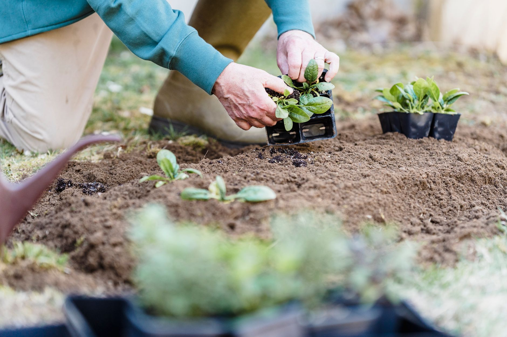

If your dahlias, gladiolus, or cannas just got knocked back by the first frost, you have a narrow window to save them for next year. These aren't hardy bulbs like tulips or daffodils that shrug off a Zone 5 winter underground — they're tropical and subtropical natives that rot or freeze solid if left in the ground past the first real cold snap. The plants that gave you armloads of cut flowers all summer are now sitting in soil that's about to kill them, and digging, curing, and storing them properly is what stands between this year's garden and next year's.

**Quick answer:** Once frost blackens the foliage, cut the stems back to 2-4 inches, wait a few days to a week for the skins to toughen, then dig well outside the clump with a garden fork to avoid spearing the tubers or corms. Shake or rinse off loose soil, let everything air-dry in a shaded, airy spot for several days to a few weeks depending on the type, then pack the dried bulbs in a barely damp medium like vermiculite or peat moss inside ventilated boxes. Store them somewhere dark and cool — 40-50°F is the target for most types — and check on them monthly through winter for rot or shriveling.

## Why These Bulbs Can't Stay in the Ground

"Tender bulb" is a catchall gardeners use for several different underground storage structures — dahlias and tuberous begonias grow tubers, gladiolus and crocosmia grow corms, cannas and most elephant ears grow rhizomes — but they all share one trait that matters here: none of them evolved to survive a hard freeze. In their native ranges (Mexico and Central America for dahlias, South Africa for gladiolus, the tropics for cannas and caladiums), the ground never freezes, so the plant never needed a strategy for it. When soil temperatures drop into the low 30s and below, the water inside those fleshy tissues expands and ruptures the cell walls, turning a firm tuber into a mushy mess by spring.

That's the key difference from the spring-blooming bulbs most gardeners plant in fall. If you've ever [planted tulips or daffodils in October](/blog/how-to-plant-spring-bulbs-in-fall/), those go into the ground and stay there — cold is part of how they bloom. Tender bulbs need the opposite: dug up, dried out, and moved somewhere above freezing until spring.

## Which Plants Actually Need Digging

Not everything that looks bulb-like needs this treatment, and how urgently a plant needs to come up depends partly on your winter lows. Gardeners in milder regions (roughly Zone 8 and warmer) can often leave cannas and some dahlias in the ground under a heavy mulch layer, while anyone colder than that is better off digging.

| Plant | Structure | Cold tolerance | Dig if you're colder than |
|---|---|---|---|
| **Dahlia** | Tuberous root clump | Damaged below ~28°F | Zone 8 |
| **Gladiolus** | Corm | Damaged below ~28°F | Zone 7 |
| **Canna** | Rhizome | Survives light frost, not a hard freeze | Zone 7 (mulch may work in Zone 7-8) |
| **Caladium** | Tuber | Damaged by any frost, even light | Zone 10 |
| **Tuberous begonia** | Tuber | Damaged below ~32°F | Zone 9 |
| **Elephant ear (Colocasia)** | Corm/rhizome | Survives light frost, not hard freeze | Zone 7 (mulch may work in Zone 8-9) |
| **Crocosmia** | Corm | Often hardy to Zone 6 with mulch | Zone 5 |

If you're not sure which category a plant falls into, check the tag it came with — "hardy to Zone 7" means it needs winter protection or digging anywhere colder than that, while "hardy to Zone 4" means it can stay put through a harsh winter.

## When to Dig: Timing It Right

The common mistake is digging too early or too late, and both cost you. Dig before frost and you cut the growing season short — the foliage is still feeding the tuber, building up the reserves it needs to survive storage and resprout in spring. Wait too long after a hard freeze and the cold has already damaged the tissue, even if the tuber still looks intact when you lift it.

The right window is right after the first light frost blackens the foliage but before the ground itself freezes. A light frost (upper 20s to low 30s°F) kills the top growth without reaching the tubers several inches underground, which is actually useful — it signals the plant to stop pushing energy into leaves and finish storing it in the roots. Leave the blackened stems standing for a few more days, up to two weeks if your schedule allows, so more of that stored energy migrates into the tuber before you lift it. But don't wait for a hard freeze or a string of nights in the teens and 20s, when the ground itself starts to freeze and the damage reaches the tubers.

Caladiums are the exception — they're damaged by any frost at all, so dig them in late summer or early fall before the first cold night, well ahead of the timeline for dahlias and gladiolus.

## Tools and Materials You'll Need

- A **garden fork** (a spade works, but a fork is less likely to slice through a tuber)
- **Pruners or loppers** to cut back blackened foliage
- A **hose or bucket of water** for rinsing soil off, if you prefer that method over shaking
- **Cardboard boxes, mesh crates, or paper grocery bags** with some ventilation — never sealed plastic bins or bags, which trap moisture against the bulbs
- A **storage medium**: vermiculite, peat moss, coarse sand, or dry wood shavings/sawdust (vermiculite is the easiest to find and work with for most home gardeners)
- A **permanent marker and tags or masking tape** for labeling varieties, since dahlia tubers in particular are nearly impossible to tell apart once the stems are gone

## How to Dig, Cure, and Store Tender Bulbs

1. **Cut the stems back to 2-4 inches above the ground** once frost has blackened the foliage, the same hard cutback timing you'd use when [deciding what else to prune back this fall](/blog/fall-pruning-what-to-cut-and-what-to-leave/). Leaving a short stub gives you something to grab onto while lifting, and it marks the clump's location.
2. **Dig in a wide circle, 6-8 inches out from the stem**, working the fork down and under the clump before lifting. Tubers and corms often spread wider than the stem suggests, and digging too close is the single most common way gardeners accidentally spear or slice into the structures they're trying to save.
3. **Lift the whole clump gently and shake or brush off loose soil.** Rinsing dahlia clumps with a hose makes the tubers easier to see before dividing, but it's optional — either dry-shaken or rinsed clumps store fine once properly dried.
4. **Let the clump air-dry in a shaded, well-ventilated spot** — a garage, covered porch, or shed out of direct sun and rain works well. Gladiolus corms need the longest cure, about 2-3 weeks at room temperature, before you snap off the old shriveled corm from the base of the new one. Dahlia clumps need far less: a few days to a week, just long enough for the surface to dry and any cut or nicked spots to callus over. Curing too long leaves dahlia tubers visibly shriveled; curing too little traps moisture that turns to rot in storage.
5. **Divide dahlia clumps now if you want more plants next year**, cutting between tubers so each division keeps a piece of the crown with at least one visible eye (the small bump where next year's shoot emerges) — a tuber without an eye won't sprout. If you're not confident identifying eyes yet, store the whole clump undivided and split it in spring, when the eyes are easier to see as they start to swell.
6. **Label everything before you lose track of varieties.** Write the name on a tag tied to the stem stub, or use a separate box per variety — unlabeled dahlia tubers look nearly identical once the color-coded flowers are gone. The cut foliage itself is healthy green or brown plant matter, so it's fine to toss in the [compost pile](/blog/how-to-compost-at-home/) rather than the trash, unlike diseased material you'd want to bag up instead.

## Choosing the Right Storage Medium and Conditions

Once cured, bulbs go into a ventilated container layered with a storage medium, then somewhere cool, dark, and stable. The medium buffers humidity — enough moisture that the tuber doesn't shrivel over months of dry air, not so much that it rots.

| Bulb type | Medium | Moisture level | Ideal temperature |
|---|---|---|---|
| **Dahlia** | Vermiculite, peat moss, or dry sawdust | Lightly dampened — barely moist to the touch | 40-50°F |
| **Gladiolus** | Mesh bag or paper bag, no medium needed | Completely dry | 35-45°F |
| **Canna** | Peat moss or vermiculite | Lightly dampened | 45-55°F |
| **Caladium** | Peat moss or vermiculite | Dry to barely damp | 50-60°F |
| **Tuberous begonia** | Peat moss or dry sand | Dry to barely damp | 45-55°F |

A basement, unheated closet, or the floor of an attached garage that doesn't freeze are the usual spots that hit these ranges. Avoid a heated basement near a furnace (too warm, which wakes bulbs up early) and an unheated shed in a cold climate (too close to freezing). If you're already finding space for other [fall garden cleanup tasks](/blog/divide-and-transplant-perennials-in-fall/), a cool mudroom or stairwell corner is often the most stable spot in the house.

## Common Storage Mistakes and How to Fix Them

| Symptom | Likely cause | Fix |
|---|---|---|
| Tubers are soft, mushy, or smell sour | Too much moisture in the storage medium, or stored in a sealed container with no airflow | Discard any clearly rotten tubers; for the rest, switch to a drier medium and a ventilated box, and check more often |
| Tubers are shriveled and lightweight | Storage medium or room too dry | Lightly mist the medium (not the tubers directly) every few weeks; some growers wrap dahlia tubers individually in plastic wrap to slow moisture loss |
| Mold on the outside but tuber feels firm | Normal humidity fluctuation, not necessarily fatal | Wipe off with a dry cloth or soft brush; if it returns repeatedly, the room is too humid for that medium |
| Early sprouting mid-winter | Storage room too warm | Move to a cooler spot; early sprouts are usually weak and can be removed without killing the tuber |
| Can't tell which variety is which | No labeling at dig time | Not fixable now — label every box next fall before this happens again |

## Checking on Bulbs Through Winter

Don't pack bulbs away and forget them until spring. Check the boxes once a month for the two failure modes above — soft or rotting tissue, and dried-out shriveling. Pull and discard anything that's clearly gone soft before it spreads rot to its neighbors. If you find a few shriveled tubers, lightly misting the storage medium (not the tubers directly) usually plumps them back up within a couple of weeks.

It's also a good moment to confirm the storage spot itself is holding steady — a cheap thermometer left in the box is worth the glance. If temperatures swing with the weather outside, the space isn't insulated enough, and bulbs will dry out or sprout early no matter how well you cured them going in.

## FAQ

### Can I leave tender bulbs in pots instead of digging them into storage boxes?

Yes, if the pot can move somewhere cool and frost-free for winter — an unheated garage or enclosed porch, for instance. Stop watering once foliage dies back and let the soil dry out; the pot becomes the storage container. This works especially well for cannas and elephant ears, which handle the disturbance of digging less gracefully than dahlias do.

### Do I need to divide dahlia tubers before storing them, or can that wait until spring?

Either works. Dividing in fall is easier because the eyes are sometimes more visible right after digging, but spring division is lower-risk for beginners, since the eyes swell and become easier to identify as the tuber wakes up. If you're unsure, store the clump whole and divide in spring.

### My gladiolus corms came up tiny and shriveled compared to what I planted. Is something wrong?

Not necessarily — gladiolus corms are naturally replaced each season. The old corm you planted shrivels as a new, larger one forms on top of it, often with small cormels clustered around the base. Discard the withered old corm once it's dry, keep the firm new one, and grow the cormels on for a couple of seasons if you want more plants.

### What happens if I just leave my dahlias in the ground this winter?

In a mild climate (roughly Zone 8 and warmer) with good drainage and a thick mulch layer, some gardeners get away with it, though results vary with how cold the winter gets. In Zone 7 and colder, an unprotected clump is very likely to freeze and rot before spring — digging and storing is the reliable option if you want to keep a specific variety going.
