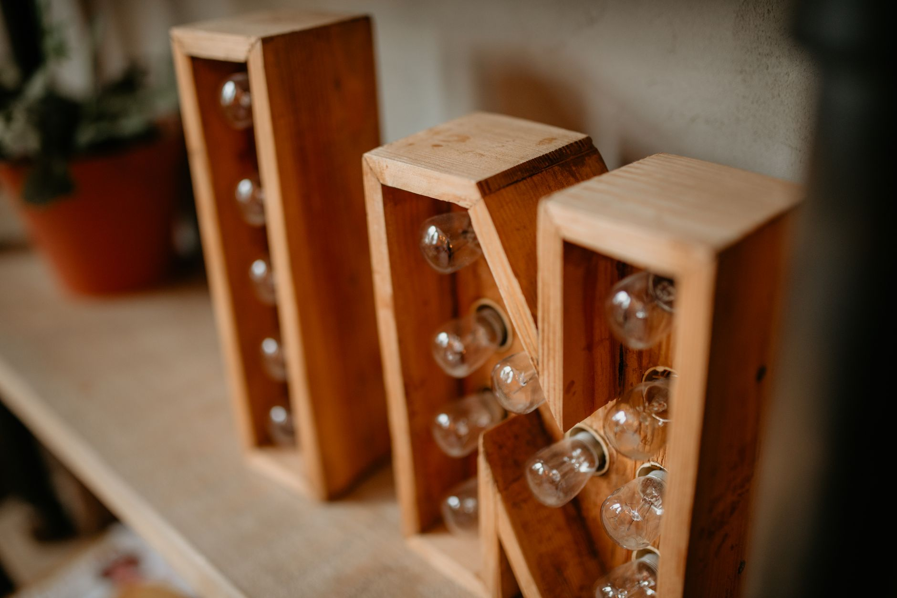

A pendant light built from a scrap of wood and a lamp cord kit looks like an electrical project, but the plug-in version most people actually want doesn't touch your home's wiring at all. You're connecting a cord to a socket the same way you would for a table lamp, then giving it a wood body instead of a ceramic base. What trips people up isn't the wiring — it's picking hardware rated for the heat a bulb puts off, drilling holes that don't split the wood, and knowing exactly where "plug-in project" ends and "call an electrician" begins.

**Quick answer:** Build the body from a piece of 3/4-inch-thick hardwood or reclaimed board at least 2 inches wide, drill a 7/8-inch hole for a UL-listed keyless porcelain or phenolic lamp socket (never plastic, which can deform from bulb heat), and wire it to an 18-gauge SPT-1 or SPT-2 cord kit with a molded plug and a strain-relief bushing where the cord exits the wood. Use an LED bulb rated 60 watts or less so the socket and wood stay cool, keep at least 1-2 inches of clearance between the bulb and any wood surface, and hang it from a ceiling hook anchored into a joist rather than drywall alone. This whole project is a plug-in fixture — if you want it hardwired into a ceiling box with no visible cord, that part of the job goes to a licensed electrician.

## Project Overview

| Detail | Estimate |
|---|---|
| **Difficulty** | Beginner to intermediate (the wiring is simple; the drilling takes a steady hand) |
| **Active time** | 2-3 hours |
| **Total time** | A single afternoon, plus overnight if you finish the wood first |
| **Rough cost** | $25-50 for a single pendant, using a scrap or reclaimed board |
| **Skill you'll use most** | Drilling clean, centered holes in wood |

This covers a single pendant on a plug-in cord. If you're picturing a cluster of three or more over a kitchen island, build and test one first — scaling up mostly means repeating the same socket-and-cord steps, not relearning them.

## What You'll Need

**Materials**

- A 3/4-inch-thick board at least 2 in wide and 6-12 in long — reclaimed fence board, a leftover 2x6 offcut, or a thick wood scrap all work, as long as it's solid (no plywood edges, which can delaminate near heat)
- 1 UL- or ETL-listed keyless lamp socket, porcelain or phenolic (heat-resistant), with a standard E26 base and a 1/8 IP threaded nipple
- 1 lamp cord kit: 18-gauge SPT-1 or SPT-2 two-conductor cord, molded plug, and a matching strain-relief bushing (sold together as a "pendant light kit" at most hardware stores)
- 1 inline rocker switch for the cord (optional, but easier than crawling under furniture to find an outlet switch)
- 1 LED bulb, 60-watt equivalent or less, A-shape or vintage-style filament bulb
- 1 heavy-duty ceiling hook and a swag hook anchor, or a cup hook rated for at least 10 lb
- Wood finish: oil, wax, or wipe-on polyurethane
- Wood glue (only if building a hollow box shape rather than a solid block)

**Tools**

- Drill with a 7/8-inch spade or Forstner bit (match it to your socket's nipple diameter — check the packaging) and a smaller bit for the cord channel
- Wire strippers and a small flathead screwdriver
- Sandpaper, 120 and 220 grit
- Tape measure and a pencil
- Clamp to hold the wood steady while drilling

## Plug-In vs. Hardwired: Which One Are You Actually Building

Most tutorials blur this line, and it's the single most important decision before you cut anything.

| | Plug-in pendant (this project) | Hardwired pendant |
|---|---|---|
| **Wiring involved** | Cord to socket, same as a table lamp | Household circuit wiring into a ceiling junction box |
| **Who can do it** | Any careful DIYer | A licensed electrician, in most areas by code |
| **Visible cord** | Yes, runs to an outlet or is routed along the ceiling with cord clips | No, fully concealed |
| **Permanence** | Easy to move or take down | Fixed in place |
| **Cost beyond materials** | None | Electrician's labor, sometimes a permit |
| **Best for** | A single accent light, a rental, or testing the look before committing | A finished, permanent light over an island or dining table |

If the room already has a ceiling box and you want a clean, cordless look, build the wood body and bulb assembly yourself exactly as described here, then hand the final connection to the house wiring to an electrician — the socket steps are the same, you're just stopping short of that last hookup, which is the one part of this project worth not doing solo.

## Step 1: Prepare the Wood

Cut your board to size and sand it through 120 then 220 grit, rounding over any sharp edges. If you're using reclaimed wood, check it the way you'd check a [pallet before building furniture from it](/blog/diy-pallet-coffee-table/) — skip anything with a chemical smell, oily staining, or active rot. Apply your finish now, before wiring, so you're not getting oil or stain on the socket or cord, and let it cure fully; oil finishes in particular need a day or more before they stop off-gassing.

## Step 2: Drill the Socket Hole and Cord Channel

Mark the center of where the socket will sit. Clamp the wood down and drill the socket hole with your spade or Forstner bit, going slowly to avoid blowout on the back side — back the bit out periodically to clear sawdust, and finish the last eighth-inch of depth from the opposite face if drilling all the way through. Then drill a smaller hole from the top edge down to meet the socket hole; this is the channel the cord runs through. A cordless drill with a clutch setting makes this easier than a corded one, since you can dial back torque on the narrow channel hole to avoid snapping a long bit — the same control worth knowing about from our [cordless drill buying guide](/blog/cordless-drill-buying-guide/).

## Step 3: Wire the Socket

Thread the socket's nipple through the hole from the bottom and secure it with the included locknut, snugged by hand plus a quarter turn with pliers — overtightening can crack a porcelain socket. Feed the cord down through the top channel, leaving a few inches of slack. Strip about 3/4 inch of insulation from each conductor, twist the strands, and hook each wire clockwise around its terminal screw before tightening, so the screw pulls the loop tighter instead of pushing it off. Lamp cord has one conductor with ribbed insulation (neutral) and one smooth (hot) — match ribbed to the silver screw and smooth to brass. Reversing them doesn't usually stop the light from working, but it does mean the socket's threaded shell stays live even with the switch off.

## Step 4: Add the Strain Relief and Switch

Install the strain-relief bushing where the cord exits the wood — it keeps the cord from flexing and eventually fraying right at the exit point, the most common failure spot on any plug-in fixture. If adding an inline switch, cut the cord a comfortable reach down from the fixture and follow the switch's included wiring diagram; most clip onto the cord without any stripping at all. Plug in a bulb and test the fixture on a table before hanging anything — fixing a loose connection is easier now than once it's on the ceiling.

## Choosing a Bulb and Socket That Won't Scorch the Wood

Wood and hot bulbs are a bad combination if you ignore clearance and wattage, and a good one if you respect both.

- **Use LED, not incandescent or halogen, for anything enclosed in or close to wood.** A 60-watt-equivalent LED bulb draws a fraction of the wattage of an actual 60-watt incandescent and runs far cooler at the glass and base, which matters most in the first inch or two around the socket.
- **Keep at least 1-2 inches of clearance** between the bulb's glass and any wood surface, more if you're using a decorative filament-style LED that runs warmer than a standard LED.
- **Check the socket's wattage rating**, stamped on the socket itself or its packaging — most keyless porcelain sockets are rated for 60-200 watts, but stay well under that ceiling when wood is involved, regardless of what the socket can technically handle.
- **Skip painted or lacquered plastic sockets entirely.** They're fine for a lamp with airflow around it but can soften or discolor faster than porcelain or phenolic in a tighter wood enclosure.

## Step 5: Hang It

For a swag-style plug-in pendant, the cord does double duty as both the electrical connection and part of how the fixture hangs, usually draped from a ceiling hook to a wall outlet with cord clips along the way. Anchor the hook into a joist, not just drywall — finding one works the same way as locating studs for a [floating shelf](/blog/diy-floating-shelf/), since a hook screwed only into drywall can pull free under the fixture's weight over time. If the hook location is higher than a step stool reaches comfortably, use a properly sized ladder rather than stretching from furniture — our guide to [choosing the right ladder](/blog/how-to-choose-a-ladder/) covers matching height and duty rating to overhead work like this.

## Common Mistakes

| Mistake | Why it backfires | Fix |
|---|---|---|
| Using a plastic lamp socket | Can soften, discolor, or melt slightly near a bulb's heat | Use porcelain or phenolic, both heat-resistant |
| Skipping the strain-relief bushing | Cord flexes and frays right where it exits the wood, eventually exposing bare wire | Install the bushing included with most cord kits |
| Drilling the socket hole undersized | Forcing the nipple through can crack the wood or strip the threads | Match the bit size to the nipple diameter listed on the socket packaging |
| Using a high-wattage incandescent bulb | Builds up heat against the wood over hours of use, discoloring or drying it out | Use an LED rated well under the socket's maximum wattage |
| Hanging from drywall alone | The hook can pull loose under the fixture's weight, especially with any swinging motion | Anchor into a ceiling joist |
| Wiring the hot and neutral backwards | The socket's shell can stay energized even with the switch off | Match ribbed cord insulation to the silver (neutral) terminal, smooth to the brass (hot) terminal |

## Safety Notes and When to Call an Electrician

Only use cord, sockets and bulbs that carry a UL or ETL listing — that mark means the hardware has been tested for the heat and current it claims to handle. Never leave spliced or exposed wire uncovered, and always test the fixture on a table before hanging it where a loose connection would be harder to reach. If you want this fixture permanently wired into a ceiling electrical box with no cord in sight, if you're adding several pendants on a shared switch, or if local code requires a permit for fixed lighting, that work goes to a licensed electrician — not because the wiring is exotic, but because connecting to a home's circuits incorrectly is a fire and shock risk in a way a table-lamp-style cord connection isn't.

## FAQ

### Can I use a dimmer switch with a DIY wood pendant light?

Yes, but use an inline cord dimmer rated for LED bulbs specifically — standard incandescent dimmers often cause flickering or buzzing with LEDs. Check the dimmer's packaging for LED compatibility before buying.

### How do I keep the wood from darkening or scorching near the bulb?

Clearance and bulb choice do almost all the work: keep at least 1-2 inches between the bulb and any wood surface, and use an LED bulb instead of incandescent or halogen. If you notice any darkening after weeks of use, switch to a lower-wattage-equivalent bulb or increase the clearance.

### Is it safe to hardwire this into my ceiling myself?

Building the wood body and wiring the socket to a cord is a safe DIY task. Connecting that fixture permanently into your home's electrical circuit through a ceiling junction box is a different job, and in most areas it requires a licensed electrician. When in doubt, keep it a plug-in fixture.

### What's the real difference between SPT-1 and SPT-2 lamp cord?

Both are 18-gauge, two-conductor cord, but SPT-2 has thicker insulation around each conductor, making it slightly more durable and better suited to fixtures that get handled or repositioned often. SPT-1 is thinner and more flexible, which is fine for a pendant that hangs in one place once it's installed.
