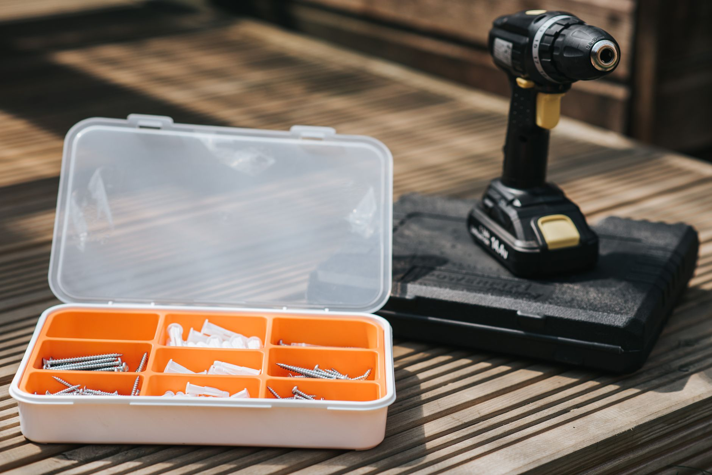

Most of the extension cords sitting in a garage drawer got there for one job and now get used for everything: holiday lights, a shop vacuum, a portable generator during an outage, maybe a space heater on a cold morning. The cord doesn't know the difference, but the wire inside it has limits, and those limits are exactly what most people never check. A cord that's fine for a string of LED lights can overheat badly enough to melt its own insulation if it's asked to carry a space heater's full draw across 100 feet, and the failure mode isn't a tripped breaker — it's a hot cord nobody was watching. This guide breaks down what the numbers and letters printed on a cord's jacket actually mean, so you can match the right cord to the job instead of grabbing whatever's closest to the door.

**Quick answer:** Match the cord's wire gauge and length to the amps the device actually draws — a thicker gauge (lower AWG number) and a shorter run both carry more current safely. For light-duty indoor use (lamps, phone chargers, holiday lights under 10 amps), a 16-gauge cord works. For power tools, shop vacuums, and most household appliances, use a 14- or 12-gauge cord rated for the distance involved. For a generator, a window AC unit, or any high-draw device over 15 amps, step up to 10-gauge and keep the run as short as possible. Outdoors or anywhere a cord could get wet, use one marked for outdoor or wet-location use (look for a "W" in the cord-type code), never an indoor-only cord. And for a plug-in space heater specifically, the safest answer is no extension cord at all — plug it straight into the wall.

## Why Wire Gauge Is the Spec That Actually Matters

Extension cords are usually sold by length first and gauge second, which is backwards from how they should be chosen. Gauge — measured in AWG (American Wire Gauge) — describes how thick the copper conductor inside the cord is, and thickness is what determines how much current it can carry without overheating. Confusingly, a *lower* AWG number means a *thicker* wire: 12-gauge wire is thicker and carries more current than 16-gauge wire, the opposite of what the numbers might suggest at a glance.

Resistance in a wire turns some of the electricity flowing through it into heat, and a thinner wire has more resistance for a given length. Ask a thin cord to carry more current than it's rated for, and that heat has nowhere to go — the insulation is the first thing to suffer, well before a typical household breaker (usually rated 15 or 20 amps) would trip and cut power. This is also why cord length matters independently of gauge: resistance adds up over distance, so a 100-foot run of a given gauge carries noticeably less safe current than a 25-foot run of the same gauge. A cord rated fine at the store for "15 amps" is often only accurate at a shorter length than the one you actually need.

## Decoding the Letters on the Cord Jacket

Every extension cord sold in the U.S. is printed with a cord-type code — a short string of letters that tells you more than the packaging usually does. The most common ones:

- **S** — flexible, portable cord ("service" cord), the base designation for nearly all extension cords.
- **J** — "junior" service, rated for 300 volts instead of 600; this is what almost every household extension cord uses, since household circuits run at 120V.
- **T** — thermoplastic insulation, the standard jacket material for general-purpose cords.
- **W** — rated for outdoor and wet-location use. This is the letter to look for if the cord will ever touch grass, a deck, or snow.
- **O** — oil-resistant outer jacket, mostly relevant for workshop and job-site cords.
- **E** — thermoplastic elastomer insulation, a more flexible, cold-tolerant alternative to standard PVC-type insulation, often used in cords marketed for cold-weather or outdoor use.

Put together, **SJTW** is the designation you'll see on most general-purpose outdoor extension cords, and it's a safe default for anything that might end up outside or in a garage. **SPT-1** and **SPT-2** (a lighter, flat "parallel" cord type) show up on indoor-only items like lamp cords and holiday light strings — fine for their intended low-draw use, but not built for moisture or heavier loads. If a cord's tag doesn't include a "W," treat it as indoor-only, even if it feels sturdy.

## Extension Cord Types Compared

| Type | Typical gauge | Rated for outdoor/wet use | Best for | Limitations |
|---|---|---|---|---|
| **Light-duty indoor (SPT-1/SPT-2)** | 16-18 AWG | No | Lamps, holiday lights, phone chargers, small electronics | Low amp capacity; damaged easily; not weather-safe |
| **Medium-duty indoor/outdoor (SJTW)** | 14-16 AWG | Yes | Power tools, shop vacs, patio lights, short-run appliances | Not ideal for heavy draw over long distances |
| **Heavy-duty outdoor (SJTW, 12 AWG)** | 12 AWG | Yes | Generators, pressure washers, longer runs to power tools | Bulkier and more expensive than lighter cords |
| **Contractor/high-amp (SJOOW or similar, 10 AWG)** | 10 AWG | Yes | Window AC units, high-draw shop equipment, long generator runs | Heavy, stiff in cold weather, overkill for small devices |

## Matching Gauge and Length to the Amps You're Drawing

Once you know roughly how many amps a device draws (check its nameplate or manual — watts divided by 120 gives a rough amp estimate for most household devices), match it against the cord's rated capacity for the length you need. As a widely used rule of thumb for 120-volt household cords:

| Cord length | 16 AWG | 14 AWG | 12 AWG | 10 AWG |
|---|---|---|---|---|
| Up to 25 ft | 13A | 15A | 20A | 30A |
| 26-50 ft | 10A | 15A | 20A | 30A |
| 51-100 ft | Not recommended | 12A | 15A | 25A |
| 101-150 ft | Not recommended | Not recommended | 12A | 20A |

These figures are a general guideline, not a substitute for the rating printed on your specific cord — manufacturers vary slightly, and the printed label is the final word. The pattern that matters is the trend: as a run gets longer, the safe amp capacity for any given gauge drops, which is why a cord that's perfectly fine at 25 feet can be the wrong choice for the same device at 100 feet. This is the same reasoning that applies to a [portable generator](/blog/portable-generator-buying-guide/) during an outage — running it far from the house means a heavier-gauge cord, not just a longer one.

## Decision Guide: Which Cord Should You Buy

1. **Running holiday lights or a small lamp outdoors?** A 16-gauge SJTW-rated cord under 50 feet covers most light strings. Check the total wattage of everything plugged into one cord — stringing multiple sets together quickly adds up.
2. **Powering a shop vacuum, [leaf blower](/blog/leaf-blower-buying-guide/), or drill at a job site?** A 14- or 12-gauge SJTW cord in the 25-50 foot range handles most corded power tools without a voltage drop that would make the tool underperform.
3. **Running a generator to the house during a power outage, including to a [backup sump pump](/blog/test-and-winterize-your-sump-pump/)?** Go with 12-gauge or heavier, rated for outdoor use, and keep the run as short as the generator's safe placement (well away from doors, windows, and vents) allows.
4. **Powering a window air conditioner or other high-draw appliance?** Check its nameplate amps first; many exceed what a 14-gauge cord can safely carry, so 10- or 12-gauge is often necessary.
5. **Thinking about a space heater?** Don't use an extension cord for one at all if you can avoid it — plug it directly into a wall outlet instead. Heaters draw close to the maximum a household circuit allows, and the connectors on a typical extension cord plug aren't designed for that sustained a load. Our [space heater buying guide](/blog/space-heater-buying-guide/) covers this in more detail.
6. **Need one cord that covers the most situations?** A 50-foot, 12-gauge SJTW cord is the closest thing to a universal choice for garage and yard use — thick enough for most tools and appliances, rated for outdoor conditions, and long enough for most yards without needing to daisy-chain a second cord.

## Common Mistakes

| Mistake | Cause | Fix |
|---|---|---|
| Cord feels hot to the touch during use | Gauge too thin for the device's amp draw or the length used | Check the device's amp rating against the cord's rated capacity for that length; size up if it's close |
| Tools run sluggish or underpowered | Voltage drop from an undersized cord or a run that's too long | Use a heavier gauge or shorter cord; avoid daisy-chaining two cords together |
| Indoor cord used outside and degrades quickly | No "W" rating, so the jacket isn't built for UV, moisture or temperature swings | Use an outdoor-rated (SJTW or similar) cord for anything outside, even briefly |
| Cord left coiled tightly while in use | A coiled cord traps heat that a straight one would dissipate | Uncoil cords fully when running higher-draw devices, especially on reels |
| Breaker trips repeatedly with a cord in use | Combined load of the cord's device plus whatever else is on that circuit exceeds the breaker's rating | Move one device to a different circuit rather than assuming the cord is at fault |
| Cracked or brittle cord still in use | UV exposure and cold-weather flexing over multiple seasons | Inspect cords each fall and retire any with cracked insulation, exposed wire, or a loose plug |

## Safety Notes and When to Call an Electrician

- Never cut, splice, or modify a damaged extension cord — replace it. A nicked or cracked jacket is a shock and fire risk, not a cosmetic issue.
- Don't run cords under rugs or carpets, where heat can build up unnoticed and foot traffic accelerates wear on the insulation.
- Keep outdoor connections off the ground when possible, or use a cord cover rated for the purpose, to reduce water and abrasion exposure.
- Avoid overloading a single cord or outlet with multiple high-draw devices through a power strip; a power strip doesn't increase what the circuit or the cord feeding it can safely carry.
- If you find yourself relying on extension cords in the same spot permanently — a workshop corner, a shed, an outdoor kitchen — that's a sign the space needs a properly installed outlet instead. A licensed electrician can run a new circuit, which is safer and usually cheaper in the long run than replacing melted cords.
- If a breaker trips immediately when a device is plugged in, or a cord or outlet shows scorch marks, stop using it and have the circuit checked before continuing.

## FAQ

### Can I use an indoor extension cord outside for just a few minutes?

It's not worth the risk. Indoor-rated cords lack the moisture-resistant jacket of outdoor cords, and even brief contact with wet grass or snow can create a shock hazard. Keep a dedicated outdoor-rated cord on hand instead.

### Is it safe to connect two extension cords together to reach farther?

It works, but it adds resistance and effectively creates a longer run than either cord's label accounts for, which can push you past the safe amp capacity for the combined length. If you regularly need more reach, buy a single cord rated for that full length rather than daisy-chaining two.

### Why does my power tool seem weaker with a long extension cord?

That's voltage drop — over a long or undersized cord, the tool receives less voltage than it needs to run at full power, which can also shorten a motor's lifespan over time. Switching to a heavier gauge for long runs usually solves it.

### Does a thicker extension cord cost more to run?

No — a cord itself doesn't use electricity or add to your bill. The gauge only affects how much current it can carry safely, not how much power the connected device actually draws.
