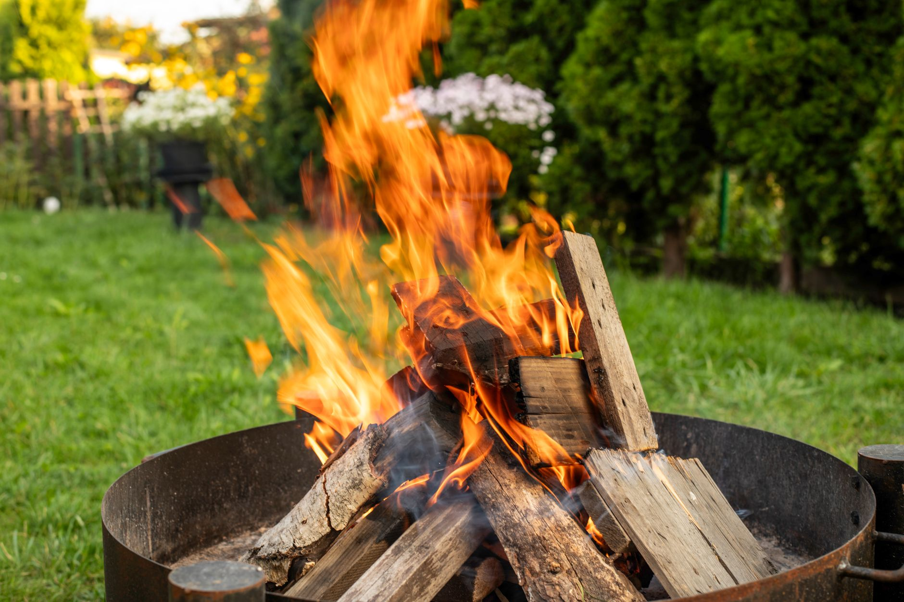

Once the evenings turn cold, "we should get something for the backyard" usually narrows down to one of three things: a fire pit, a built outdoor fireplace, or a chimenea. They all burn fire outdoors, but they solve different problems, cost wildly different amounts, and come with different rules about where you're allowed to put them. Picking based on looks alone is how people end up with a $3,000 masonry fireplace that heats a space they only use twice a year, or a chimenea that cracks its first winter because nobody mentioned it needs to come in out of the rain.

**Quick answer:** A fire pit gives the most heat and the best gathering-around-a-circle experience for the lowest cost, and it's the one you can realistically build yourself. A built outdoor fireplace throws heat in one direction toward seating, works well against a wall or under a covered patio, and is the most expensive and most permanent option. A chimenea is the cheapest, most portable and most decorative of the three, but it throws the least usable heat and needs the most careful handling to avoid cracking. Match your pick to how much heat you actually need, how permanent you want the feature to be, and what your local fire code and HOA allow.

## The Three Options, Defined

- **Fire pit** — a contained, usually circular, fire feature either sunk into the ground, built as a low wall of blocks or stone, or bought as a freestanding steel or copper bowl. Open on top, so heat and light radiate in every direction and seating can wrap all the way around it.
- **Outdoor fireplace** — a vertical, chimney-style masonry or prefabricated structure, almost always built against a wall or as a standalone feature with a back and two sides, leaving one open face. Heat and light project forward, toward whatever seating faces it, the same way an indoor fireplace does.
- **Chimenea** — a free-standing, bulb-shaped unit, traditionally clay but also made in cast iron or steel, with a narrow chimney at the top. Originally a cooking and heating feature, now mostly decorative with a secondary function as a small, contained fire source.

## Comparison: Heat, Fuel, and Cost Tier

| Feature | Heat output | Heat direction | Typical cost tier | Portable? | DIY feasibility |
|---|---|---|---|---|---|
| **Fire pit (in-ground or block)** | High | 360°, radiates outward evenly | Low to moderate | No, once built | Buildable as a weekend project |
| **Fire pit (freestanding bowl)** | Moderate to high | 360° | Low to moderate | Yes | None needed; assembles out of the box |
| **Outdoor fireplace (prefab kit)** | Moderate | One direction, forward only | Moderate to high | No | Usually a multi-day project; often needs two people |
| **Outdoor fireplace (custom masonry)** | Moderate | One direction, forward only | High | No | Contractor project; footing and code review |
| **Chimenea (clay)** | Low | Mostly upward, some forward through the mouth opening | Low | Yes, but fragile to move | None needed |
| **Chimenea (cast iron or steel)** | Low to moderate | Mostly upward, some forward | Low to moderate | Yes | None needed |

## How Much Heat and Ambiance Each One Really Gives

The table above is the short version. In practice, the differences show up fastest around how a group actually sits and talks.

**A fire pit is the only one of the three built for a circle of people.** Because the flame is open on all sides, everyone gets roughly the same view and the same warmth no matter where they sit, which is why fire pits dominate backyard gatherings. The tradeoff is that open flame also means more exposure to wind, which can blow smoke toward whoever's downwind and push heat away from the group on a breezy night.

**An outdoor fireplace throws its heat and light in a single direction**, the same way a living-room fireplace does. That makes it the better choice for a patio where seating is already arranged facing one wall, or for a covered porch where you want a focal point rather than something to sit around. It also means anyone sitting to the side gets very little benefit from it, so plan seating in a loose semicircle facing the opening, not scattered around the yard.

**A chimenea looks like serious fire but delivers the least heat of the three.** Its narrow body and chimney are designed to draw the fire up and out rather than radiate it outward, which is closer to a stove's mechanics than an open hearth's. It's genuinely better suited to a small patio, a balcony with enough clearance, or as a decorative accent near a seating area that has its own primary heat source. Treating it as your main backyard heater for a group of six is where people end up disappointed.

## Fuel Types and What They Mean for Upkeep

Each feature can usually run on more than one fuel, and the fuel changes the maintenance far more than the shape does.

- **Wood-burning** (common in fire pits and chimeneas): the most ambiance and the most radiant heat per fire, but it produces smoke, ash and creosote buildup that needs regular cleaning out. Burn only dry, seasoned wood — green or wet wood smokes heavily and burns cooler. If you're building or buying a wood-burning feature, our guide to [seasoning and storing firewood](/blog/how-to-season-and-store-firewood/) covers how long different species actually take to dry and how to tell when wood is ready, and a [covered firewood rack](/blog/diy-firewood-storage-rack/) keeps the supply dry between uses.
- **Propane**: close to instant on and off, far less smoke, and no ash to clean, but it runs on tanks that need refilling and it's the fuel least suited to chimeneas, which aren't designed to vent a sustained gas flame safely. Most propane fire pits and some fireplace inserts use it.
- **Natural gas**: the most convenient long-term if you're already set up for a built-in feature, since it runs off a line instead of tanks, but it requires a licensed plumber to run the gas line and isn't something to retrofit onto a portable chimenea or bowl.

## Codes, Clearances, and Site Requirements

Every one of these features is regulated somewhere, and the rules differ enough by fuel and structure type that it's worth checking before you buy anything.

| Requirement | What to check |
|---|---|
| Local fire code | Minimum distance from structures, fences and property lines; many require 10-25 ft for open-flame fire pits |
| HOA rules | Some ban wood-burning features entirely or restrict them to gas |
| Burn bans | Many counties suspend wood fires during dry spells; gas features are usually exempt |
| Surface | Never place a wood-burning fire pit or chimenea directly on a wood deck; use a fire-rated mat or build on gravel, pavers or concrete |
| Permits | Masonry fireplaces and any gas line installation usually require a permit and inspection; portable fire pits and chimeneas generally do not |
| Overhead clearance | No branches, wires, umbrellas or roof overhangs above any of the three |

If you land on an open fire pit and want to build rather than buy, our [DIY paver fire pit guide](/blog/diy-backyard-fire-pit/) walks through site selection, the gravel base and stacking the blocks, and covers the same clearance rules in more detail.

## Decision Guide: Match the Feature to Your Yard

1. **Is the main goal a gathering spot for a group?** A fire pit wins here; it's the only shape designed for seating all the way around.
2. **Do you already have fixed seating facing one direction, like a covered patio against the house?** An outdoor fireplace fits that layout better than a fire pit ever will.
3. **Is space tight — a small patio, balcony, or rental with no permanent fixtures allowed?** A chimenea is the only one of the three that's both small-footprint and fully portable.
4. **Do you want the lowest possible ongoing maintenance?** A propane fire pit or fireplace insert beats any wood-burning option, since there's no ash, creosote or smoke smell to manage.
5. **Is budget the deciding factor?** A freestanding steel fire pit bowl or a basic clay chimenea costs far less than a prefab fireplace kit, which in turn costs far less than custom masonry.
6. **Are you renting or might you move in a few years?** Favor the freestanding bowl or the chimenea; both travel with you. A built fireplace or in-ground pit stays with the house.

## Common Mistakes

| Mistake | Cause | Fix |
|---|---|---|
| Chimenea cracks after one winter | Left outside uncovered through rain and freeze-thaw cycles; clay absorbs water that expands when it freezes | Store indoors or under full cover in winter, and never pour cold water into a hot chimenea |
| Fire pit built too close to a deck or fence | Guessing at clearance instead of checking local code | Measure the actual required distance for your jurisdiction before digging or assembling |
| Constant smoke and poor burn | Burning unseasoned or wet wood | Switch to properly dried, seasoned wood, or move to propane if smoke is the dealbreaker |
| Fireplace heats a space nobody sits in | Seating arranged without checking which way the opening faces | Arrange chairs in a loose semicircle facing the opening before finalizing the fireplace's position |
| Rust forming on a steel fire pit bowl within a season | No cover, left exposed to rain and snow | Use a fitted weatherproof cover between uses and after each rain |
| Chimenea mouth cracking from use | Building a large, hot fire too quickly in a cold clay body | Start with a small fire to warm the clay gradually, then build it up |

## Safety Notes and When to Call a Pro

- Keep a hose, bucket of water, or fire extinguisher within reach any time you light any of these, regardless of fuel.
- Never use a wood-burning feature in a fully enclosed or tightly screened space; smoke and carbon monoxide need somewhere to go.
- A propane or natural gas conversion kit should only be installed or connected by someone familiar with gas-rated fittings; a loose connection is a safety issue, not just a maintenance one.
- Call a licensed plumber for any natural gas line run to a fireplace or fire pit — this is not a DIY gas job.
- Call a mason or contractor for a custom outdoor fireplace that needs a footing; improper footings can crack or shift under seasonal ground movement.
- Check with your insurance provider before installing a permanent fire feature; some policies ask about them.

## FAQ

### Which is cheapest to buy and run: a fire pit, fireplace, or chimenea?

A basic chimenea or a freestanding steel fire pit bowl costs the least upfront, and wood fuel is typically cheaper per use than propane. A custom masonry fireplace costs the most by a wide margin, both to install and, if it runs on natural gas, to have professionally connected.

### Can I put any of these on a wood deck?

Not a wood-burning fire pit or chimenea directly on the boards — the heat and stray embers are a fire risk. A fire-rated mat or pad rated for the feature's heat output is required by many manufacturers and local codes; check the product's specifications and your local rules before placing one on any wood surface.

### Do chimeneas actually provide useful heat, or are they just decorative?

They provide some real heat, but far less than a fire pit or fireplace of similar size, because their narrow shape is built to draw flame upward rather than radiate it outward. Treat a chimenea as a decorative accent or a feature for one or two people sitting close by, not as the main heat source for a group.

### How do I know if my yard even allows an open wood fire?

Check your city or county fire department's website, or call them directly — rules vary block to block in some areas, let alone city to city. HOAs often add their own restrictions on top of local code, so check your covenant documents too if you're in a managed community.
