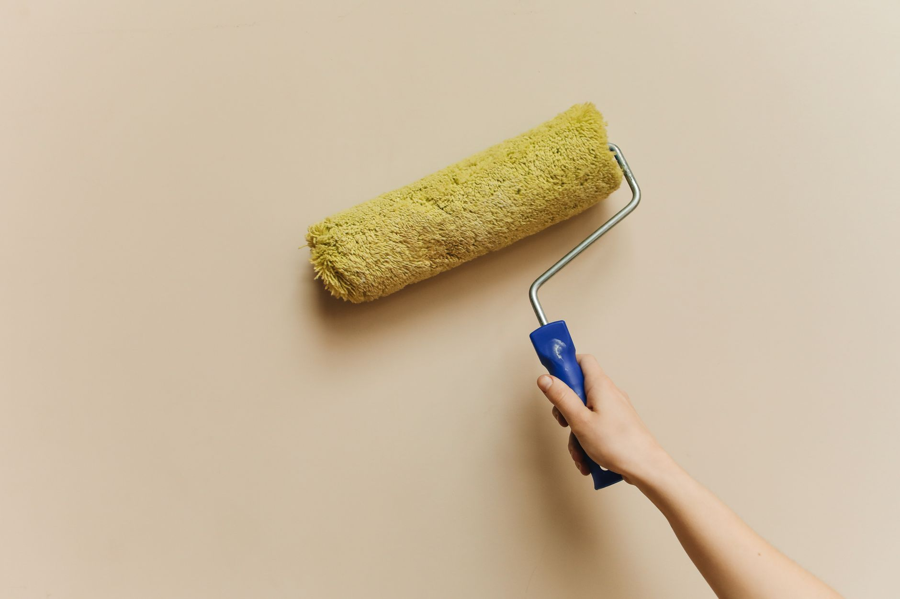

A fireplace that sat unused since last winter isn't the same appliance you banked a fire in back in March. Birds and squirrels build nests in open flues over the summer, creosote left on the liner doesn't go anywhere on its own, and masonry that took on moisture during spring storms can crack where you can't see it from the hearth. None of that announces itself until you light the first fire of the season — exactly the wrong moment to find out. A half-hour of checking now is what separates a fireplace you can trust from one that's quietly becoming a fire or carbon monoxide risk — the same kind of pre-season attention worth giving your [furnace](/blog/get-furnace-ready-for-winter/) before you rely on either one.

**Quick answer:** Before your first fire of the season, open the damper and shine a flashlight up the flue to check for blockages (nests, debris, visible creosote buildup), vacuum out last season's ash, inspect the firebox and hearth for cracks, and test your smoke and carbon monoxide detectors. If you see more than about 1/8 inch of sooty, tar-like creosote on the liner, smell a strong odor from the fireplace, haven't had an inspection in over a year, or aren't sure when the chimney was last swept, book a certified chimney sweep before you burn anything. Gas fireplaces need a different checklist — a technician check of the burner, pilot and venting rather than a sweep — but skipping it carries the same risk.

## Why This Can't Wait Until You Need the Fireplace

Chimney fires and carbon monoxide incidents both spike in the first few weeks of heating season, and the common thread is usually the same: a flue or vent that was fine the last time anyone looked, months or years earlier. Creosote — the flammable, tar-like byproduct of burning wood — builds up gradually every time you use a wood-burning fireplace or stove, and it doesn't flake off or evaporate during the off-season. It just waits for the next fire hot enough to ignite it. Burning only well-[seasoned firewood](/blog/how-to-season-and-store-firewood/) instead of green or wet wood slows this buildup, since unseasoned wood burns cooler and smokier, depositing more creosote per fire.

Gas fireplaces don't produce creosote, but they're not maintenance-free either. Pilot assemblies collect dust over the summer, venting can get blocked by debris or insect nests, and a cracked heat exchanger or misaligned burner can push carbon monoxide into the room instead of outside. CO has no smell, so a working detector is doing a job your senses can't.

Most of what causes these problems is catchable with a flashlight, a vacuum, and twenty minutes before the first cold snap — not after you've already started relying on the fireplace to heat a room.

## What You Can Safely Check Yourself

This is a visual inspection and basic cleaning, not a chimney sweep — leave removing creosote from the flue liner to a professional with the right tools. The goal here is catching obvious problems and ash buildup.

**Tools and materials:**

- Flashlight (a headlamp frees up both hands)
- Shop vacuum with a fine-dust filter, or an ash vacuum rated for fireplace ash
- Work gloves and a dust mask
- A fireplace poker and small hand broom
- A mirror on an extendable handle (optional, helps see up the flue without climbing)
- Drop cloth or old sheet to protect the floor in front of the hearth

**Steps, in order:**

1. **Make sure the fireplace is cold.** Ash can hold embers for 24-48 hours after a fire looks out, so don't start this if you've burned anything in the last two days.
2. **Open the damper fully and check that it moves freely.** A damper that's stuck or won't fully open can't be fixed by force — a seized one needs a sweep or HVAC tech before you light a fire, since a partially blocked flue is a major reason smoke and CO back up into the room.
3. **Shine a flashlight up the flue from the firebox.** You're looking for daylight at the top (confirms it's clear), and checking for nests, leaves, or other debris silhouetted against it. Animals commonly nest in flues over spring and summer, especially if there's no cap.
4. **Look at the flue liner for creosote.** From the firebox, you can usually see the first couple of feet. A light dusting of soot is normal and expected; a thick, shiny, tar-like coating — especially anything that looks like it's dripping or glazed — is a fire hazard and a sign the chimney needs professional cleaning before use.
5. **Vacuum out old ash, leaving a thin layer (about an inch) if you plan to burn wood again** — a shallow ash bed actually helps insulate the next fire and makes it easier to get coals going. Bag the ash and let it sit in a metal container outside for several days before disposal, since embers can smolder in ash far longer than it looks like they should.
6. **Inspect the firebox brick and mortar for cracks, and the hearth extension for chips or gaps.** Small hairline cracks in firebrick are common and not usually urgent; cracks you can fit a fingernail into, or mortar that's crumbling out in pieces, mean the firebox isn't protecting the surrounding structure the way it should.
7. **Check the chimney cap and flashing from the ground with binoculars, or from a ladder only if you're comfortable and set up safely** — our guide to [choosing the right ladder](/blog/how-to-choose-a-ladder/) covers sizing if you don't already have one you trust for this. Look for a cap that's rusted through, dented shut, or missing a spark screen, and flashing that's lifted where the chimney meets the roof — a common source of the kind of leaks covered in [preventing ice dams](/blog/how-to-prevent-ice-dams/).
8. **Test smoke and carbon monoxide detectors near the fireplace and on every level of the home**, and confirm you have at least one CO detector if you don't already — replace batteries now rather than finding out they're dead mid-winter.

## When You Need a Professional Chimney Sweep (Not Just a Cleaning)

A sweep isn't just cleaning — a certified sweep also inspects what you can't see from the firebox: the full interior of the flue, the damper assembly, and often the liner's structural condition via camera.

| Sign | What it usually means | What to do |
|---|---|---|
| Visible creosote thicker than about 1/8 inch, or glazed/shiny deposits | Active creosote buildup, elevated chimney fire risk | Schedule a sweep before burning again |
| You can't remember the last inspection, or it's been over a year of regular use | Annual inspection is the standard recommendation for wood-burning fireplaces and stoves, even with light use | Book an inspection as routine maintenance |
| Strong smoky or sour odor from the fireplace, especially in humid weather | Creosote reacting with moisture, or debris in the flue | Have it inspected before your next fire |
| Smoke backing up into the room instead of drawing up the flue | Blocked or undersized flue, damper issue, or negative pressure in the house | Don't use the fireplace until a sweep or HVAC tech diagnoses it |
| White or gray staining on exterior chimney brick | Water penetrating the masonry (efflorescence) | Have the chimney crown, cap and flashing checked for leaks |
| Bought or moved into a home with a fireplace you've never used | Unknown maintenance history and liner condition | Get a Level 1 inspection before the first fire |
| Visible gaps, cracks or missing mortar in the exterior stack | Structural deterioration that can let heat or sparks reach framing | Have a mason or certified sweep assess before use |

If any of these apply, don't light a fire "just to see" — chimney fires often start silently within the flue, and a flue already compromised by creosote or cracks is how a small fire becomes a structural one.

## Wood-Burning vs. Gas Fireplace: Different Prep, Same Deadline

The two systems fail differently, so "get the fireplace ready" means different tasks depending on which one you have.

| | Wood-burning | Gas (fireplace or insert) |
|---|---|---|
| **Main seasonal risk** | Creosote buildup, chimney fires | Blocked venting, pilot or burner issues, CO leaks |
| **Who to call** | Certified chimney sweep (CSIA-certified where available) | HVAC technician or gas fireplace service tech |
| **How often** | Annual inspection is standard for regular use; sweep when creosote warrants it | Annual inspection recommended, even though there's no creosote to remove |
| **What you can DIY** | Visual check, ash removal, cap/flashing check from the ground | Visual check of the burner area for dust and debris, battery/detector checks — leave the gas line and pilot assembly to a pro |
| **First-use test** | Small, well-ventilated test fire with damper fully open, someone present the whole time | Run on pilot and main burner for a few minutes with windows cracked, watching for unusual smell or soot on the glass |

Whichever type you have, the vent run itself needs the same once-a-year attention — a gas insert vented through an old masonry chimney can inherit that chimney's cracks and blockages.

## Common Mistakes With Fireplace Prep

| Mistake | Why it's a problem | Better approach |
|---|---|---|
| Lighting the first fire without checking the flue at all | Nests, debris or heavy creosote go unnoticed until smoke backs up or worse | Always do the flashlight/damper check before the season's first fire |
| Assuming a gas fireplace doesn't need yearly attention | Dust, debris and venting issues build up even without creosote | Book an annual check for gas units too, not just wood-burning ones |
| Storing ash in a plastic bin or cardboard box right after cleaning | Embers can smolder for days and ignite the container | Use a metal container and let ash cool outside for several days first |
| Skipping the chimney cap inspection because "it looks fine from the ground" | Dents, missing screens and animal entry points are easy to miss from a distance | Use binoculars or have a sweep check it as part of the inspection |
| Running a space heater near the fireplace instead of fixing a draft problem | Treats the symptom, not the underlying flue or damper issue | Diagnose draft and backup problems at the source before working around them |
| Closing the damper too soon after a fire looks out | Residual embers need airflow to fully die out; closing it traps heat and gases | Wait until ash is completely cold, typically a full day or more, before closing |

## Safety Notes and When to Call a Professional

Treat any of the following as a stop-and-call situation: smoke that won't draw up the flue, a strong gas smell near a gas fireplace (leave the house and call your gas utility's emergency line), visible structural damage to the chimney stack, or a carbon monoxide detector that goes off. None of these are DIY fixes — testing your way through them with a fire burning is how minor problems become emergencies.

For routine but technical work — actually removing creosote from the flue, repairing a cracked firebox or liner, or servicing a gas burner and pilot assembly — hire a certified chimney sweep or HVAC technician. The inspection and basic cleaning in this guide tell you whether you need that call, not replace the need for it.

## FAQ

### How often does a wood-burning fireplace actually need a professional sweep?

It depends more on how much you burn than the calendar, but an annual inspection before the season starts is standard even for light use, since creosote and structural issues build gradually and aren't reliably visible from the firebox. If you burn several times a week all winter, you may need a mid-season cleaning too.

### Is it safe to use a fireplace that hasn't been inspected in several years?

Not without checking it first. Years of unmonitored creosote, animal nesting, or undetected mortar damage are exactly the conditions behind chimney fires and structural failures, and none of those are things you can rule out with a quick glance. Treat a long-neglected fireplace as needing a full Level 1 inspection, not just the basic DIY check in this guide.

### Can I clean creosote out of the flue myself with a chimney brush?

You can for light, dusty soot if you're comfortable on a roof and have the right brush size for your flue, but it's not the same as a professional sweep's inspection, and heavy glazed creosote often needs stronger methods a homeowner brush won't fully remove. Given the fire risk, most homeowners are better off paying for a sweep than guessing whether a DIY clean got the flue down to a safe level.

### My gas fireplace doesn't use wood — does it still need yearly maintenance?

Yes. There's no creosote, but dust and spider webs can block the pilot or burner ports, venting can get obstructed from outside, and parts like thermocouples wear out over time. An annual check catches these before they cause a no-light pilot or, in rarer cases, a venting problem that lets exhaust gases back into the room.
