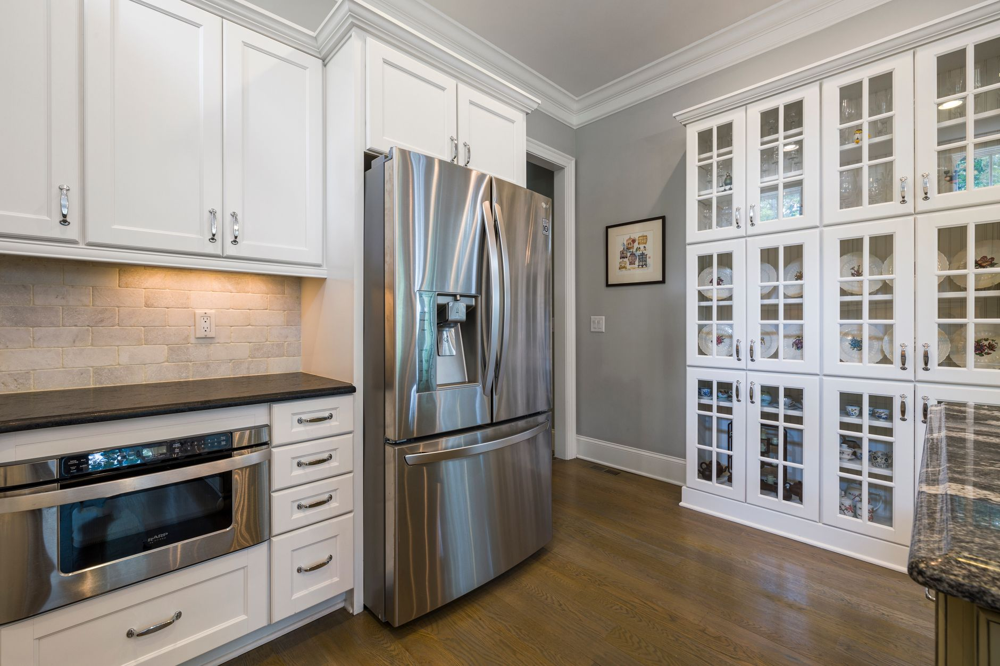

If your garage sits uninsulated and attached to the house, it's acting as a giant cold-air buffer pressed against your living space — and the door itself, a thin sheet of steel or aluminum with no real thermal break, is usually the single biggest gap in that buffer. Insulating it is one of the cheaper, more DIY-friendly winter projects on a home improvement list, but the kits sold for it vary a lot in material, R-value and how much effort they actually take to install well, and picking the wrong one for your door is how people end up with panels that sag out of their tracks by February.

**Quick answer:** A rigid foam panel kit (polystyrene or polyisocyanurate, cut to fit each door panel and held in place with retainer clips) gives the best balance of R-value, cost and DIY install time for most steel garage doors, typically adding R-6 to R-13 depending on panel thickness. A reflective foil-faced kit is cheaper and faster to install but adds less insulating value and works best in milder climates or for radiant heat control rather than cold winters. Batt-style kits made for garage doors add the most R-value but cost more and take longer to fit around each panel's ribs and hardware. Whichever kit you choose, the insulation only pays off if you also seal the perimeter gaps around the door — a well-insulated panel still loses heat through an unsealed edge.

## What to Expect From a DIY Insulation Kit

A properly installed kit won't turn an attached garage into a heated room, but it does meaningfully narrow the temperature swing between the garage and the rest of the house, keep pipes and anything stored against the shared wall from flirting with freezing, and make the door itself noticeably warmer to the touch — a reasonable proxy for how much heat it was radiating away before. Expect a half-day project for a standard two-car door if you're using a kit designed for your door's panel layout: measuring and labeling each panel takes the most time, the cutting and fitting goes faster once you have a rhythm, and no specialized tools are required beyond a utility knife and a tape measure. This is a comfortable weekend project for someone who's handled basic DIY work before — nothing here requires electrical or structural skill, though the safety notes below cover one real exception.

## Comparing Garage Door Insulation Kits

Garage doors are usually either steel (most common, in sectional panels with ribbed backs) or aluminum, and the kit you need depends on that panel depth and rib pattern as much as on your climate. Here's how the three common options stack up:

| Kit type | Typical R-value added | Install difficulty | Best for |
|---|---|---|---|
| **Reflective foil-faced bubble/foam** | R-3 to R-6 | Easy — cut with scissors, often self-adhesive | Mild climates, garages used mainly for storage, fastest budget fix |
| **Rigid foam panel (EPS, XPS or polyiso)** | R-6 to R-13, depending on thickness | Moderate — measure and cut each panel, secure with retainer pins or clips | Most steel doors in cold-winter climates, the best cost-to-performance balance |
| **Batt-style kit (fitted foam or fiberglass sleeves)** | R-10 to R-18 | Moderate to involved — more pieces to fit around panel ribs and hardware | Attached garages used as a workshop or living-adjacent space, where maximizing R-value matters more than install time |
| **Spray foam (professional)** | R-20+ | Not DIY — requires professional application | Garages being converted to conditioned space, or doors with unusual panel shapes a kit won't fit |

Reflective kits are the cheapest and fastest but work primarily by blocking radiant heat gain — useful against summer sun on a west-facing door, less useful against winter cold. If your main complaint is a garage (and the rooms next to it) that feel cold from October through March, a rigid foam kit is the better match for the money, which is why it's the one walked through step by step below.

## What You'll Need

- A rigid foam garage door insulation kit sized for your door (most are sold by door width — 8', 9' or 16' — and come with enough foam panels and retainer clips for a standard sectional door)
- A tape measure
- A straightedge and a sharp utility knife (a drywall or foam-cutting blade holds up better than a standard one)
- A marker or pencil
- A rag and mild cleaner, for wiping down the panel backs before installing clips or adhesive
- Step stool or short ladder, for the top panels

## Step-by-Step: Installing a Rigid Foam Panel Kit

1. **Close the garage door fully and disconnect the opener** by pulling the manual release cord, so the door can't cycle while you're working on it. Prop it so it won't slide if your model doesn't lock automatically when closed.
2. **Measure each panel individually rather than assuming they're identical.** Garage door panels often vary by a half-inch or more between the top and bottom of the same door because of how the track curves, and a kit cut to one size across the board is the most common reason panels end up loose.
3. **Wipe down the back of each panel** to remove dust and grease, since both the retainer clips and any adhesive strips bond better to a clean surface.
4. **Mark your foam panels using the measurements from step 2**, labeling each one for its position (top-left, second-from-bottom-right, and so on) before cutting, so you're not re-measuring mid-install.
5. **Cut the foam panels along the straightedge**, cutting slightly undersized (about 1/8 inch smaller on each dimension) rather than flush — foam that's cut exactly to measurement tends to bow or bind against the panel's ribs once you try to seat it.
6. **Install the retainer clips or pins included with the kit** at the corners and center of each recessed section, following the kit's spacing instructions — this is what actually holds the foam in place long-term, not friction alone.
7. **Press each foam piece into its recessed panel section** until it sits flush against the retainers. If a section has a vent, window, or the opener's reinforcement bar, trace around it before cutting rather than trying to notch the piece after it's already cut to overall size.
8. **Reconnect the opener** and run the door through a full open-close cycle before loading anything against it, checking that no panel rubs the track or interferes with the rollers.
9. **Step back and check the door's balance** — see the safety section below for why this matters more than it sounds like it should.

The comfort payoff from this kind of project usually shows up away from the garage itself — a mudroom, laundry room or kitchen that shares a wall with the garage often runs noticeably warmer once the door stops acting as a cold sink, the same indirect win you get from [getting the furnace itself ready for winter](/blog/get-furnace-ready-for-winter/) rather than just turning up the thermostat to compensate for a leaky house.

## Don't Stop at the Panels: Sealing the Perimeter

Insulated panels do nothing for the air leaking around the door's edges, and that perimeter gap is often the bigger source of heat loss on an older door. Check three spots: the bottom seal (the rubber astragal that meets the floor — replace it if it's cracked, flattened, or no longer compresses evenly along its length), the side and top weatherstripping (the vinyl or rubber strip set into the door frame, which hardens and shrinks with age the same way the seals around your [exterior doors and windows](/blog/how-to-weatherstrip-doors-and-windows/) do), and the gap between door panels themselves, where foam-filled doors seal noticeably better than hollow ones. A bottom seal replacement and a roll of frame weatherstripping together typically cost far less than the insulation kit itself and take under an hour to install — doing both at once, rather than just the panels, is what actually closes the gap between "insulated" and "sealed."

If your garage doubles as a workshop — a reasonable reason to care about keeping it warmer in the first place — pairing this with a cold-weather check of how you've organized the space, like a [pegboard, slatwall or French cleat tool wall](/blog/pegboard-vs-slatwall-vs-french-cleat-tool-wall/) or a [garage workbench](/blog/diy-garage-workbench/) set up away from the door, keeps tools and project materials further from the coldest wall in the room.

## Common Garage Door Insulation Mistakes

| Mistake | Cause | Fix |
|---|---|---|
| Panels fall out within a few months | Relying on adhesive strips alone instead of mechanical retainer clips | Use the clips or pins included with the kit; add extras at panel centers if the manufacturer allows it |
| Foam rubs against rollers or the track | Panels cut oversized, or cut flush instead of slightly undersized | Trim 1/8 inch off each dimension and test the door cycle before loading the garage back up |
| Door won't stay open on its own after installing insulation | Added panel weight has thrown off the spring tension balance | Have the opener's force settings and spring tension checked — don't adjust torsion springs yourself (see safety notes) |
| Insulation installed but the garage still feels drafty | Perimeter seals and bottom astragal were never addressed | Replace the bottom seal and frame weatherstripping along with the panel kit |
| Foam crumbles or degrades within a season | EPS foam used in a garage that gets direct sun exposure through a window, without a foil facing | Choose a foil-faced or XPS product for any panel section that gets regular sun |
| Kit doesn't fit panels with windows or a center rail | Cut to overall panel size without accounting for hardware | Measure and cut around windows, vents and the horizontal reinforcement strut individually |

## Safety Notes and When to Call a Professional

Added insulation weight is the one real safety issue in this project. Garage door springs are calibrated to the door's original weight, and a few extra pounds of foam spread across a large sectional door can be enough to throw off the balance — a door that used to stay put halfway open might now drift down, or the opener might strain and trip its safety reversal more often. Test this after installing: with the opener disconnected, lift the door manually to waist height and let go. It should stay roughly in place; if it drifts down noticeably, the spring tension needs adjusting.

Do not adjust torsion springs yourself. They're under enough tension to cause serious injury if released improperly, and this is squarely a job for a garage door technician — the same way a gas line or an electrical panel is outside the scope of a weekend project. If your opener's force settings need recalibrating after an insulation install, most manufacturers document the adjustment screws in the owner's manual, but if the door still doesn't behave safely afterward (doesn't reverse on contact with an obstruction, doesn't fully close, or struggles visibly), stop and call a professional rather than troubleshooting further yourself.

## FAQ

### Does insulating a garage door actually lower heating bills?

It helps most in an attached garage sharing a wall with conditioned living space, where the door is currently the weakest point in that shared boundary. The effect is smaller in a detached garage or one that's already well air-sealed elsewhere; in those cases, the bigger comfort win is keeping the garage itself above freezing rather than any measurable change on a heating bill.

### Will the extra weight damage my garage door opener?

Not if you check and correct the spring balance afterward. A chain or belt-drive opener rated for a standard sectional door can usually handle the added weight of a foam kit without issue, but skipping the balance check is how people end up with an opener straining on every cycle, which does shorten its life over time.

### Can I insulate a garage door that has windows?

Yes, but measure and cut around each window individually rather than trying to notch a single large piece — window openings interrupt the panel's recessed section unevenly, and most kits include smaller precut or trimmable pieces specifically for this.

### How long does a garage door insulation kit last?

A properly retained rigid foam kit typically holds up for the life of the door with no maintenance, though foam exposed to direct sun through an uncovered window can degrade faster — a foil-faced product resists that better than plain EPS. Reflective kits with an adhesive-only installation tend to need the most upkeep, since the strips are the first thing to fail.
