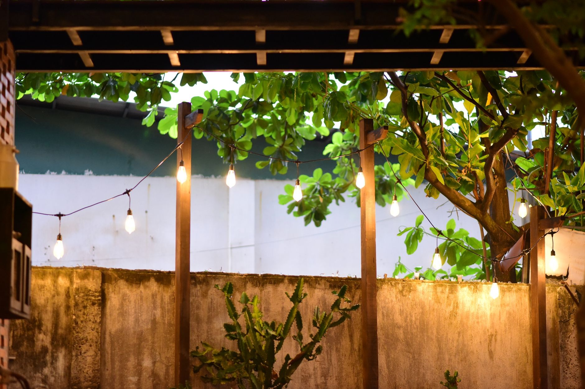

The week after Thanksgiving is when most outdoor holiday lighting goes up, and it's also when most of it goes up wrong. Not catastrophically wrong — usually just a strand that goes dark by New Year's, a GFCI outlet that trips every time the porch lights and the icicle strand both run, or a dozen tangled strings crammed into a bin that takes an hour to sort out next November. None of that is bad luck. It comes from skipping the planning step and treating holiday lights as something you just plug in and forget, when they're really a small, temporary electrical installation with real limits on how much current a strand, a clip, or a cord can carry.

**Quick answer:** Measure your layout before buying anything, and choose LED strands over incandescent if you're covering more than a short stretch — LEDs draw a fraction of the current, which means longer runs, fewer outlets needed, and a lower fire risk. Use clips rated for your surface (gutter clips, shingle tab clips, or masonry clips) instead of nails or staples, which puncture siding and cut through cord insulation. Plug everything into a GFCI-protected outlet, respect each strand's maximum end-to-end connection limit printed on the box or tag, and use only cords and extension cords rated for outdoor, wet-location use. If a run needs more power than one outdoor circuit can reasonably handle, split it across two outlets rather than daisy-chaining past a strand's rated limit.

## Planning Your Layout Before You Buy Anything

Walk your house and yard with a tape measure before you buy a single strand. Decide what you're outlining — roofline, gutters, porch railings, windows, a tree, a walkway — and measure each run separately rather than guessing a total. Roofline and gutter runs are usually the longest stretches, and the ones most likely to come up short if you estimate from the ground.

Sketch where the nearest outdoor outlets are relative to each run. A display that needs three extension cords crossing a walkway to reach power is both a tripping hazard and harder to keep dry. If you're already using the patio or porch on cool evenings the way our guide to [extending your outdoor season into fall](/blog/extend-outdoor-season-into-fall/) covers, route holiday lighting the same way: one outlet per usable zone, not one overloaded outlet powering the whole yard.

Buying lights by the "set" rather than the exact length you measured almost always means leftover strands with nowhere to go, or a gap bridged by a mismatched spare. Round up slightly, not by a lot — two or three extra feet of slack per run is enough to route around a downspout or corner without pulling a clip loose.

## LED vs. Incandescent: Which Should You Actually Buy

This decision affects almost everything else here — how many outlets you need, how hot the strands run, and how long they last through the season.

| | LED strands | Incandescent strands |
|---|---|---|
| **Current draw** | Very low — often a fraction of a watt per bulb | Significantly higher per bulb |
| **Max connected strands end-to-end** | Typically much higher (check the tag — varies by product) | Typically lower before you need a new power drop |
| **Heat generated** | Minimal — safer near dry foliage and wreaths | Noticeably warmer; keep clear of anything flammable |
| **Color and dimmer compatibility** | Some warm-white LEDs can look slightly different from incandescent warmth; check dimmer/timer compatibility | Classic warm glow; dims smoothly on standard dimmers |
| **Upfront cost** | Usually higher per strand | Usually lower per strand |
| **Best for** | Long rooflines, multi-story runs, anyone short on outdoor outlets | Short accent runs, nostalgia displays, small budgets |

The connection limit is the detail people skip. Every strand has a maximum number that can be plugged end-to-end before the combined draw on that first plug exceeds what the wire and connectors are rated for. Exceeding it doesn't just dim the far end of the run — it makes the connectors at the start of the chain run hotter than they're designed for. Check the tag on your specific product rather than assuming a number, since it varies by manufacturer and bulb type.

For anyone doing a full roofline, multiple windows, and a tree, LEDs make the power math dramatically easier and are worth the higher upfront cost. Save incandescent for a single short run where the nostalgic warmth matters more than the power budget.

## Clips and Mounting Hardware by Surface

The fastest way to damage a roof, siding, or the strand itself is reaching for a staple gun or nails. Both puncture the surface you're attaching to and, often, the cord's insulation, creating a shock and fire risk that only worsens with each freeze-thaw cycle.

Match the clip to the surface instead:

- **Gutters:** all-in-one clips that hook over the lip without hardware. Before loading a full roofline of clips onto a gutter, confirm it's actually in good shape — a sagging gutter won't support a season of clipped lights any better than it handles rainwater, which our guide to [cleaning gutters safely](/blog/how-to-clean-gutters-safely/) covers.
- **Shingles:** tab clips that slide under the shingle edge without penetrating it.
- **Brick or masonry:** clips that grip mortar lines, or adhesive-backed clips rated for outdoor swings — never masonry nails for a seasonal display.
- **Trees and shrubs:** wrap strands loosely so branches can move in wind without snapping the cord.
- **Railings and posts:** zip ties or cable clips sized to the railing, checked partway through the season as wood expands and contracts.

Whatever clip you use, route the cord with some slack — a strand pulled taut between clips is more likely to pop loose in wind, and tension on the connectors shortens their life.

## Power, Cords, and Timers: Getting the Electrical Side Right

Every outdoor outlet used for holiday lights should be GFCI-protected — most exterior outlets built in the last couple of decades already are, identifiable by the test/reset buttons on the outlet. A GFCI outlet cuts power within a fraction of a second if it detects current leaking somewhere it shouldn't, which matters far more outdoors than indoors given rain, snow, and damp ground.

Any extension cord in the mix needs to be rated for outdoor, wet-location use — look for a "W" in the cord-type lettering — and sized for the actual load, not just whatever's long enough to reach. Our [extension cord buying guide](/blog/extension-cord-buying-guide/) covers how gauge and length interact; for holiday lights, LED runs are light enough that a standard outdoor-rated cord handles them easily, while a long incandescent run deserves a heavier-gauge cord and a shorter path.

Timers and smart plugs keep lights from running all night for no reason and take the daily on/off switching off your to-do list. A basic mechanical timer works for a simple schedule; a smart plug lets you adjust for sunset times that shift through the season, and some let you confirm from inside that an outdoor circuit is still on — useful after a storm or a tripped breaker you didn't notice.

Don't daisy-chain timers or indoor power strips into an outdoor run. Indoor-rated strips aren't built for moisture, and stacking devices rated for different loads is how a chain ends up carrying more than any single link was designed for.

## Ladder and Roofline Safety

Rooflines are the part of this project most likely to send someone to urgent care, and almost always because of the ladder, not the lights. Use a ladder sized for the actual height you're working at, with room to stand a few rungs below the top — our guide to [choosing the right ladder](/blog/how-to-choose-a-ladder/) covers sizing and duty ratings.

A few habits matter more here than on an ordinary ladder job: work with a second person spotting the ladder whenever you reach sideways to clip a strand, since reaching past the ladder's centerline is the most common way ladders tip. Keep the cord off the rungs as you climb — a cord underfoot on aluminum is a slip risk you don't need. And never work a ladder near power lines; if a roofline runs close enough that a pole or ladder could reach one, skip that section or hire it out.

Frost and dew make roofs and the ground below a ladder noticeably more slippery in late fall, so a clear, dry afternoon is safer than finishing the job in failing light after a cold, damp evening.

## Troubleshooting Common Problems

| Symptom | Likely cause | Fix |
|---|---|---|
| Whole strand is dark | Blown fuse in the plug end, or the outlet itself has tripped | Check the small fuse inside the plug first (most LED and incandescent sets have one); reset the GFCI outlet |
| Half the strand is dark | A loose or failed bulb in that section breaking the circuit | On incandescent sets, work the bulbs in the dark section to find the loose one; on LEDs with a failed section, the segment usually needs replacing |
| Strand flickers or dims gradually along its length | Too many strands connected end-to-end past the rated limit | Split the run across two outlets instead of one continuous chain |
| GFCI trips repeatedly | Moisture has gotten into a connector, or the combined load is too high for that circuit | Dry and reseat connections; move some of the load to a second outlet |
| Lights work, then fail after rain or snow | A connector wasn't rated for wet locations or wasn't seated fully | Use outdoor-rated connectors and cords, and wrap exposed connections with electrical tape rated for outdoor use |
| Timer or smart plug doesn't turn lights on at the set time | Scheduled time wasn't updated for the shifting sunset, or the device lost its Wi-Fi connection | Recheck the schedule weekly during the darkest weeks, and confirm the plug reconnects after any outage |

## Taking Lights Down Without Next Year's Tangle

How you take lights down determines how much of next November gets spent untangling instead of hanging. Wind each strand around cardboard, a store-bought reel, or loose figure-eight loops rather than balling it up — a tight ball is exactly what creates next year's knot, and it stresses the wire at sharp bend points.

Label each wound strand or bin by the run it covers — "roofline," "porch railing," "tree" — so next year's setup starts with a plan instead of a guessing game. Store sets somewhere dry and away from temperature swings; a garage shelf beats a spot near a furnace or a damp basement floor, since both heat and damp degrade cord insulation over time.

Before you pack a strand away, plug it in once more and check it end to end. Finding a dead section next November, with no memory of which clip or connector was the problem, costs far more time than spotting it now while the ladder's already out.

## Safety Notes and When to Call an Electrician

Never cut, splice, or repair a damaged cord — insulation nicked by a clip, staple, or ice is a replace-it situation. If an outdoor outlet lacks GFCI protection, or trips the moment you plug in a modest display, that's worth a licensed electrician rather than working around it with extra cords. Keep connections up off wet ground, ideally in an outdoor cord cover or elevated on a hook — a connector sitting in a puddle is a common way displays fail mid-season. And if your plan means running power near a gas meter or service line, or adding a new outlet, that's an electrician's job, not a weekend project.

## FAQ

### Can I connect LED and incandescent strands together?

It's best to avoid it. They draw very different amounts of current, which makes it harder to know how close you are to a connection's rated limit. If you must mix them for a specific look, keep each type on its own plug rather than chaining one into the other.

### How many strands can I really connect end-to-end?

It depends on the specific product — check the tag or packaging for the maximum connection count, since it varies between manufacturers and even between lines from the same brand. Treat that number as a hard limit, not a guideline.

### Is it safe to leave outdoor lights plugged in overnight?

On a GFCI-protected outlet with lights in good condition, running overnight isn't inherently unsafe, but a timer that turns them off for a few hours reduces wear on the strands and the electricity cost with no visible downside, since nobody's seeing the display at 3 a.m. anyway.

### What's the fastest way to find a dead bulb in an old incandescent strand?

Narrow it down by section first rather than checking bulbs one at a time — unplug the strand and test shorter segments if it has separable fuses, which isolates the problem area before you start swapping bulbs.
