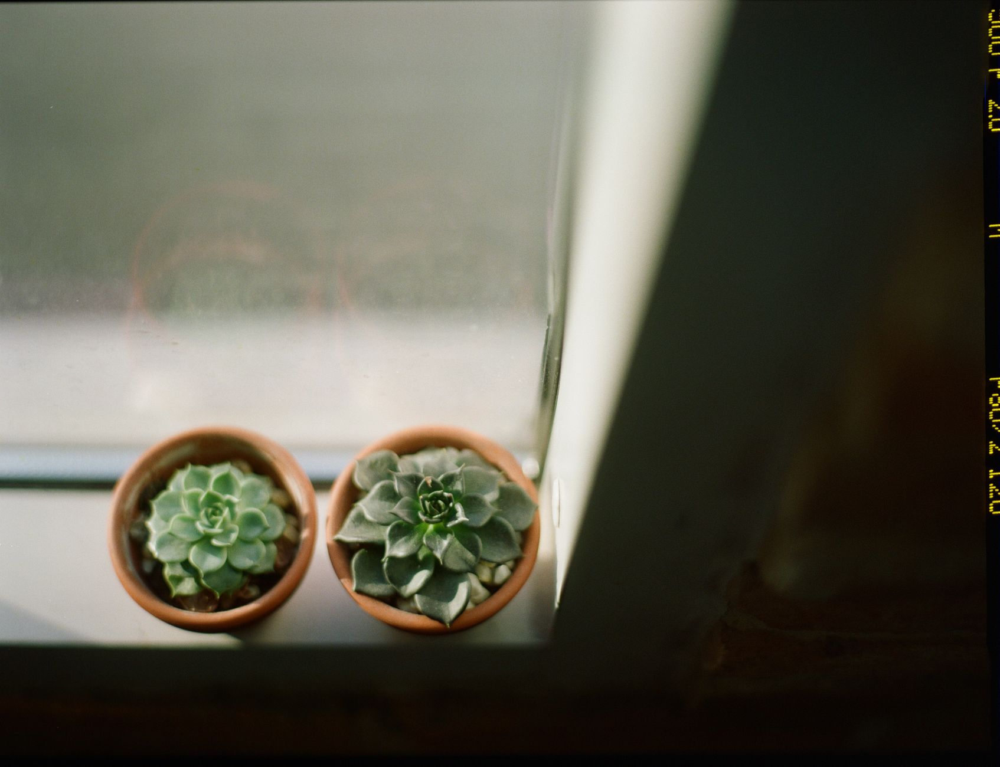

You spot what looks like a smear of lint tucked into a leaf joint, or a row of small brown bumps running along a stem that won't scrape off with a fingernail the way dirt would. Neither one looks like an insect, which is exactly why mealybugs and scale go unnoticed for so long — they don't fly, they barely move, and by the time the damage is obvious (yellowing leaves, a sticky film on the pot and the windowsill beneath it, a fine black coating on older growth) the colony behind it has usually been established for weeks. Both pests thrive in the same warm, stable indoor conditions that keep houseplants alive through winter, which is exactly why they turn up now.

**Quick answer:** Mealybugs are soft, white, cottony insects that cluster in leaf joints and along stems; scale are flat or domed bumps, usually brown or tan, that attach themselves to stems and leaf midribs and barely move once settled. Both feed by piercing the plant and sucking sap, and both excrete a sticky honeydew that can grow black sooty mold. Treat mealybugs by dabbing each visible cluster with a cotton swab dipped in 70% isopropyl alcohol, then follow with a full-plant spray of insecticidal soap or 1–2% horticultural oil. Scale needs the alcohol swab for crawlers plus manual scraping for adults, since their waxy shell blocks sprays from reaching them. Either way, one treatment isn't enough — repeat every 7 to 10 days for three to four cycles to catch newly hatched insects the first round missed.

## What Mealybugs and Scale Actually Look Like

Mealybugs are soft-bodied insects, usually 2–4 millimeters long, covered in a white, waxy coating that makes them look like small tufts of cotton or lint. They favor tight, hidden spaces: the joint where a leaf meets the stem, the underside of a leaf along the midrib, and the crown of the plant where new growth emerges. A single mealybug is easy to mistake for a bit of debris; a cluster of them, packed into a leaf axil with their waxy filaments spreading outward, is what usually catches your eye first.

Scale insects look nothing like mealybugs once they've settled, which is part of why people miss them. Adult scale are flat or slightly domed, oval, and usually brown, tan, or gray — more like a small barnacle or a scab than an insect. They attach to stems and the undersides of leaves, especially along the midrib, and don't walk away when disturbed because by the adult stage they've essentially cemented themselves in place and feed from a fixed spot. The only mobile stage is the newly hatched "crawler," a nearly invisible nymph that moves to a new feeding site before settling down and growing its shell — which is also the stage any spray treatment actually has a chance of reaching.

Both pests leave the same secondary clue: a clear, sticky residue called honeydew on leaves, stems, and whatever surface sits below the pot. Left long enough, honeydew grows a black, powdery sooty mold on top of it. The mold itself doesn't infect the plant, but it blocks light from reaching the leaf surface, which compounds the damage the pests are already doing.

## Why They Spread Indoors Through Fall and Winter

Both mealybugs and scale reproduce fastest in warm, stable temperatures with limited airflow — close to the exact conditions inside a heated home once outdoor temperatures drop and windows stay shut. A single female mealybug can produce hundreds of eggs over her lifespan, and in a warm room a new generation can mature in a few weeks, which is fast enough for a handful of insects to become a visible colony well before you'd expect to see one.

The other common entry point is the plants themselves. A pest population that was barely noticeable outdoors in summer, kept in check by rain, wind, and natural predators, can take off once that same plant is indoors with none of those limits. If you didn't inspect new growth, leaf joints, and the soil surface closely when you brought plants in for the season, an infestation that started outside has had the entire indoor season to build — a step covered in more detail in [when to bring houseplants indoors](/blog/when-to-bring-houseplants-indoors/). New plants purchased from a nursery or big-box store are the other common source, since mealybugs and scale crawlers are small enough to hitch a ride without being noticed at checkout.

## Mealybugs vs. Scale: How They Differ and Why That Changes Treatment

The two pests get lumped together because they're both slow-moving, sap-sucking insects that produce honeydew, but their physical structure is different enough that the same treatment doesn't work equally well on both.

| | Mealybugs | Scale |
|---|---|---|
| Appearance | Soft, white, cottony clusters | Hard or waxy brown/tan bumps |
| Mobility | Slow-moving but can relocate as adults | Mobile only as newly hatched crawlers; fixed once settled |
| Where found | Leaf joints, leaf undersides, crown | Stems, leaf midribs, woody growth |
| Why sprays struggle | Waxy coating repels water-based sprays somewhat | Hard shell blocks contact sprays almost entirely on adults |
| Best single tool | Alcohol swab plus insecticidal soap or neem | Alcohol swab and manual scraping for adults, oil spray for crawlers |
| How fast it spreads | Moderate; visible clusters grow steadily | Slower to notice, but established colonies are harder to fully clear |

The practical takeaway: for mealybugs, a thorough soap or oil spray reaches a meaningful share of the population because their bodies are still relatively exposed. For scale, a spray mostly only kills crawlers — the adults' shell is close to waterproof, which is why scraping or wiping off the visible adults matters as much as spraying.

## How to Treat a Mealybug Infestation, Step by Step

**What you'll need:**
- Cotton swabs
- 70% isopropyl alcohol
- Insecticidal soap or 1–2% horticultural/neem oil solution (mixed per the product's label)
- A spray bottle, 16–32 oz
- A sink, tub, or outdoor hose
- A space to isolate the plant for several weeks

**1. Isolate the plant.** Move it away from your other houseplants immediately — mealybugs crawl between touching leaves and can also be carried on hands, tools, or a watering can. A separate room is safest for the full treatment period.

**2. Dab visible clusters with an alcohol-soaked swab.** Isopropyl alcohol dissolves the waxy coating and dries out the insect on contact. Work through every leaf joint, the underside of each leaf, and the crown of the plant — this is the step that actually kills what you can see, rather than just knocking it loose.

**3. Rinse the plant.** A firm spray of lukewarm water in a sink or shower dislodges egg masses and loosened insects that the swab didn't fully kill.

**4. Spray the entire plant with insecticidal soap or oil.** Coat every leaf surface, stem, and joint until it drips. This is what reaches newly hatched nymphs you can't see individually.

**5. Repeat every 7 to 10 days, for three to four cycles.** Mealybug eggs that survived the first treatment will hatch in the days afterward, so a single application almost never clears an infestation — the repeat cycle is the part people skip, and it's the reason the pest comes back a few weeks after they thought it was gone.

## How to Treat Scale, Step by Step

The process for scale starts the same way but adds a mechanical step, because spraying alone doesn't reliably kill adults.

**1. Isolate the plant,** for the same reasons as above.

**2. Scrape or pick off visible adult scale.** A fingernail, a soft toothbrush, or the edge of a credit card will lift most adults off a stem once you apply light pressure. This is the single most effective step against the adult stage, since their shell blocks most sprays.

**3. Follow with an alcohol swab** on the area where the scale was attached, and on any you couldn't fully remove, to kill what's left behind.

**4. Spray the whole plant with horticultural oil.** Oil works by suffocation rather than poisoning, which makes it effective against the crawler stage even though it does little to adult shells. Coverage matters more than concentration here — every stem and leaf surface needs contact.

**5. Repeat every 7 to 10 days for three to four cycles,** scraping and swabbing again each time. New crawlers hatch on a staggered schedule, so a plant that looks clear after one round often shows a fresh batch of pinhead-sized bumps within two weeks.

## Common Mistakes That Let the Infestation Come Back

| Mistake | Why it fails | Fix |
|---|---|---|
| Treating once and stopping | Eggs and crawlers that survived hatch later | Repeat every 7–10 days for 3–4 cycles |
| Spraying only the tops of leaves | Both pests cluster on undersides and in joints | Coat every surface, including leaf undersides and stem joints |
| Skipping the alcohol swab on scale | Oil and soap barely penetrate the adult shell | Scrape or swab adults directly before spraying |
| Leaving the plant next to others during treatment | Crawlers migrate to nearby foliage within days | Isolate for the full multi-week treatment window |
| Composting trimmed, infested material | Eggs and crawlers can survive in plant debris | Bag and discard pruned material in the trash |
| Ignoring the soil and pot rim | Mealybugs can hide at the soil line and under pot lips | Check and wipe the pot rim and soil surface during every treatment |

## When to Cut Your Losses — or Call a Professional

A plant with a light, newly discovered infestation is usually worth saving with the steps above. One where the stems are coated in scale, where new growth is stunted or dropping, or where you've gone through four or more treatment cycles without real improvement has likely spent more energy fighting the pest than it has left to recover — at that point, discarding the plant (not composting it) and sterilizing the pot before reuse is often more realistic than continuing indefinitely.

Call a professional, rather than continuing to treat it yourself, if the infestation has spread across several large plants or a whole room, or if you're dealing with a woody indoor tree like a ficus or citrus where the canopy is too large to treat leaf by leaf. A licensed pest control service can also advise on options beyond store-bought soap and oil if a heavy, established infestation doesn't respond to repeated home treatment.

## Keeping Mealybugs and Scale From Coming Back

Inspect any new plant closely — leaf joints, leaf undersides, and the soil surface — before it goes near your other houseplants, and keep it isolated for a couple of weeks as a quarantine period regardless of how healthy it looks. The same applies to plants that spent the summer outdoors; a quick glance isn't enough to catch a mealybug tucked into a leaf joint. Both pests also take hold faster on a plant that's already stressed, so routine care matters more than it might seem: a houseplant that's underwatered, sitting in low light, or going without [fertilizer during its active growing months](/blog/how-to-fertilize-houseplants/) is simply a weaker host. Dry, overheated indoor air doesn't cause mealybugs or scale the way it does with [spider mites](/blog/spider-mites-on-houseplants/), but a stressed plant has less reserve to resist whichever pest does arrive, so the same humidity adjustments that help against mites — covered in [raising humidity for houseplants in winter](/blog/raise-humidity-for-houseplants-in-winter/) — are worth keeping up regardless of which pest you're watching for.

## FAQ

### Can I just throw out an infested plant instead of treating it?

Yes, and for a cheap, heavily infested plant that's not sentimental, this is often the faster and less frustrating choice. If you do, discard it in the trash rather than composting it, and wipe down the pot with diluted alcohol or soapy water along with any nearby surfaces the plant touched before reusing the pot.

### Are mealybugs or scale harmful to people or pets?

No. Neither pest bites or transmits disease to people or animals, and they feed exclusively on plant sap. The main household risk is indirect: sooty mold growing on honeydew can stain surfaces, and a heavy infestation can spread to other plants nearby.

### Why do mealybugs keep coming back after I thought I got rid of them?

Almost always because the treatment stopped after one or two rounds instead of the full three to four cycles. Eggs and nymphs hidden in crevices the first treatment missed hatch over the following weeks, so what looks like a resurgence is usually just the next generation finishing its life cycle.

### Do ladybugs or other natural predators help indoors?

Predatory insects that control mealybugs and scale outdoors generally aren't practical to introduce inside a home, since they need an ongoing outdoor-like environment to survive and reproduce. Manual removal and repeated soap or oil treatment remain the more reliable approach for houseplants.
