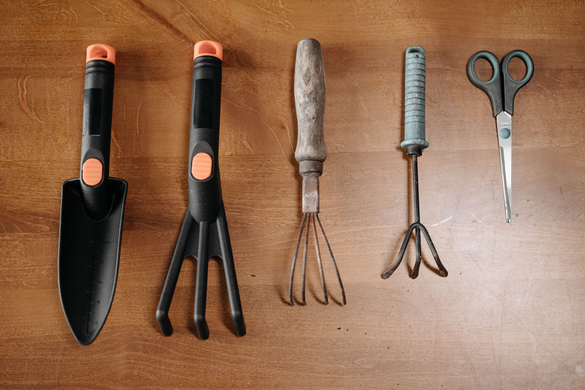

If you've got perennials, roses, hydrangeas, or small shrubs living in pots on a patio or deck, they're in more danger this winter than anything you've planted directly in a bed. A plant rated hardy to your zone can still die in a container, and the reason has nothing to do with the plant itself — it's the pot. Soil in the ground is insulated by the earth around it, which rarely drops far below the air temperature even in a hard freeze. Soil in a container is exposed on every side, so it tracks the air temperature almost exactly, and a plant's roots are far less cold-tolerant than its top growth. A perennial that would laugh off a 10°F night in the ground can have its root system killed in a pot at that same temperature — the same reason [tender bulbs like dahlias and gladiolus](/blog/dig-up-and-store-tender-bulbs-for-winter/) have to come out of the ground entirely rather than just getting mulched over.

**Quick answer:** Potted perennials and shrubs need their roots insulated beyond what the pot alone provides. The four reliable methods are moving pots into an unheated garage or shed, clustering and mulching them against a sheltered wall, sinking the pot into the ground up to its rim, and wrapping the pot itself. Which one to use depends on the plant's hardiness relative to your winter lows, the size and number of pots, and how much space and labor you have. Whichever method you pick, do it before the first hard freeze — once the root ball has frozen solid, insulating it only slows further damage, it doesn't reverse what already happened.

## Why Containers Are So Much Riskier Than Garden Beds

The rule of thumb among growers is that a plant in a container behaves like it's one to two USDA hardiness zones less hardy than the same plant in the ground. A hydrangea rated for Zone 6 in a border might only reliably survive a Zone 7 or 8 winter in a pot, because the insulating mass of surrounding earth isn't there. Below-ground soil temperature stays relatively stable through winter, while a container's soil tracks the air, dropping below freezing on any night the air does and offering the roots no buffer — the same underlying reason a [tomato in a pot](/blog/how-to-grow-tomatoes-in-pots/) needs more hands-on watering than one in a bed, just in winter's direction instead of summer's.

Material and size both matter. Terra cotta and thin plastic conduct cold quickly and can crack when wet soil inside them freezes and expands. Thick-walled resin, fiberglass, wood, and concrete hold up better and slow heat loss somewhat, though none match the ground's insulation — and a large pot, with more soil mass relative to its surface area, cools more slowly than a small one.

## Know What You're Actually Protecting

Before choosing a method, sort your containers by how much protection they genuinely need. Three questions settle it: How hardy is the plant relative to your zone — one rated two zones hardier than where you live rides out winter with minimal help, while one rated for your exact zone or marginally hardier needs real protection. Is it evergreen or deciduous — evergreens (boxwood, many conifers, holly) keep losing water through their leaves all winter even while the roots are frozen and can't replace it, a combination called winter burn, so they often need wind protection too. And how exposed is its current spot — a pot against a south-facing wall gets more reflected warmth and less wind than one standing alone in the open yard.

Plants marginally hardy for your zone, anything evergreen, and anything in a small or thin-walled pot need a dedicated plan. Plants rated two or more zones hardier than your area, in large, thick-walled pots in a sheltered spot, often get through winter with nothing more than a layer of mulch on top of the soil.

## Four Ways to Overwinter a Potted Plant

### Option 1: Move Pots Into an Unheated Shelter

Moving containers into an unheated garage, shed, enclosed porch, or cold basement protects roots from the worst of the cold without forcing the plant into active growth the way a heated space would. This is the most reliable option for marginally hardy plants, and the easiest to manage since you can check on pots whenever you want.

The space needs to stay above the plant's minimum tolerance but cold enough that it stays dormant — generally 20°F to 40°F works for most hardy perennials and shrubs. Water sparingly, just enough that the root ball never fully dries out, since a dormant plant in a cold, dark space uses very little moisture and overwatering here causes rot. Bring pots back outside gradually in spring, rather than moving a plant straight from a dark shed into full sun, which can scorch leaves that spent months in low light.

### Option 2: Cluster and Mulch Pots in Place

If you don't have indoor space for every container, group pots tightly together against a sheltered wall — the east or north side of the house, out of prevailing winter wind, works well. Clustering means each pot loses heat to its neighbors instead of the open air on every side, which slows how fast the group cools. Pile mulch, straw, or fallen leaves around and between the pots, covering the sides and mounding over the soil surface inside each one too.

This method works best for plants already close to hardy enough for your zone, since the insulation it provides is real but modest compared to moving pots indoors. It's also the practical choice for pots too heavy to carry, like a large shrub in a half-barrel planter.

### Option 3: Sink the Pot Into the Ground

Digging a hole and sinking the entire container up to its rim turns the surrounding earth back into the insulator nature intended, which is why this protects roots almost as well as planting the shrub directly in the ground. It's labor-intensive for more than a few pots, but it's the best option for a plant you want to keep containerized for next summer while giving its roots a real winter's worth of insulation.

Choose a spot that doesn't collect standing water, since a buried pot with poor drainage holds water against the roots and invites rot. Dig the hole slightly deeper and wider than the pot, set it in, and backfill around the sides, leaving the rim slightly above grade so meltwater doesn't pool into the pot. In spring, it lifts back out cleanly as long as roots haven't grown out through the drainage holes into the surrounding soil.

### Option 4: Wrap the Pot Itself

Wrapping is the fallback for containers too large or rooted in place to move, and for anyone without a sheltered spot to cluster pots. Wrap the outside in burlap, bubble wrap, or a specialty plant-pot cozy, with a thick layer of loose insulation — straw, shredded leaves, or bagged mulch — packed in the gap between the wrap and the pot wall. A cardboard box or a second, larger pot slipped around the original with insulation between the two works as a low-cost version of the same idea.

This method protects the sides of the root ball reasonably well but does less for the top of the soil, so pair it with a thick mulch layer over the exposed soil. It's the least effective of the four on its own for marginally hardy plants, but combined with a sheltered spot against the house, it closes most of the remaining risk.

## Which Method Should You Choose?

| Method | Protection level | Labor | Best for |
|---|---|---|---|
| **Move indoors (unheated)** | Highest | Moderate — carrying pots, periodic checks | Marginal-hardiness plants, evergreens, small-to-medium pots |
| **Cluster and mulch** | Moderate | Low to moderate — one-time setup | Several pots at once, plants already close to hardy enough, heavy pots you can't move far |
| **Sink in ground** | High | High — digging per pot | A few prized plants you want containerized again next year |
| **Wrap the pot** | Moderate | Low | Large permanent planters, anything too heavy or rooted to relocate |

If you're protecting more than a handful of pots, combining methods is normal — cluster the hardier ones against the house with mulch, and reserve indoor space for the plants that genuinely can't handle the cold. When you're unsure, move it indoors; that costs a little labor, while guessing wrong the other way costs you the plant.

## Timing: Do This Before the Freeze, Not After

Start insulating once nighttime temperatures are reliably dropping into the 20s, and have everything in place before the first hard freeze (28°F or colder) in your area. A light frost or two first is actually useful — it's part of how the plant hardens off and signals dormancy — but once the pot's soil is frozen solid, piling on insulation afterward does very little, since the damage it prevents has usually already happened by then. If you're also working through other [fall garden cleanup tasks like dividing perennials](/blog/divide-and-transplant-perennials-in-fall/) or deciding [what to prune back now versus in spring](/blog/fall-pruning-what-to-cut-and-what-to-leave/), potted plant protection belongs on the same pre-frost checklist.

## Common Mistakes and How to Fix Them

| Mistake | Why it hurts the plant | Fix |
|---|---|---|
| Watering heavily right before a freeze | Saturated soil freezes into a denser ice mass that holds cold longer and can crack the pot | Water normally, then let the top inch dry before a hard freeze hits |
| Leaving pots in full sun all winter | Freeze-thaw cycles from daytime sun and nighttime cold stress roots more than steady cold | Move south- and west-facing pots to a shadier, sheltered spot |
| Using a small, thin-walled pot for a marginal plant | Thin material offers almost no insulation and cools fast | Repot into a larger, thick-walled container, or plan on moving it indoors |
| Sealing pots in plastic wrap with no ventilation | Trapped moisture against the root ball promotes rot even in the cold | Use breathable wraps like burlap, and keep drainage holes clear |
| Forgetting to check on dormant plants all winter | Root balls can dry out even while dormant | Check soil moisture monthly and water lightly if dry |
| Moving plants from storage straight into spring sun | Leaves that spent months in low light scorch in sudden bright sun | Reintroduce light gradually over one to two weeks |

## Signs of Cold Damage vs. Normal Dormancy

It's easy to mistake a perfectly healthy dormant plant for a dead one, and just as easy to miss real damage until it's too late. A dormant deciduous perennial or shrub should have firm stems that don't crack when gently bent, and roots that are white or light-colored and firm when you check by loosening soil near the pot's edge. Cold-damaged tissue looks different: stems turn black, mushy, or papery-dry and snap cleanly, and damaged roots turn brown or black and feel mushy rather than firm.

The real test for a plant that looks dead in late winter is patience — wait until several weeks of consistently warmer weather have passed, since many perennials look lifeless above ground for months and still push new growth from the crown once soil warms. Scratch a small section of stem bark with a fingernail; green tissue just under the surface means it's still alive even with nothing visibly growing yet.

## FAQ

### Can I just bring all my potted perennials inside my heated house for winter?

Not usually. Most hardy perennials and shrubs need a real cold dormancy period to flower and grow normally the following year, and a warm house keeps them awake, triggering weak, leggy growth. An unheated but frost-free space — garage, shed, or enclosed porch — gives them the dormancy they need without exposing roots to a hard freeze.

### How cold is too cold for a potted plant, even with protection?

It depends on the plant's hardiness and how much insulation you've added, but a well-insulated pot can usually handle temperatures 10-15°F colder than an exposed pot of the same plant before root damage sets in. When you're not confident, moving it indoors removes the guesswork.

### Do I need to protect pots in a mild climate where it barely frosts?

Marginally hardy and evergreen plants still benefit from mulching the soil surface and moving pots out of hard wind, even where freezes are brief. True tropicals or tender perennials need to come indoors regardless, since even a single light frost can kill them outright.

### Will wrapping the pot alone protect the roots, or do I need to insulate the soil too?

Wrapping the sides alone leaves the soil surface exposed, and cold reaches roots from the top down just as much as from the sides. Always pair a pot wrap with a thick mulch layer over the soil — a few inches of straw, shredded leaves, or bark mulch closes that gap.
