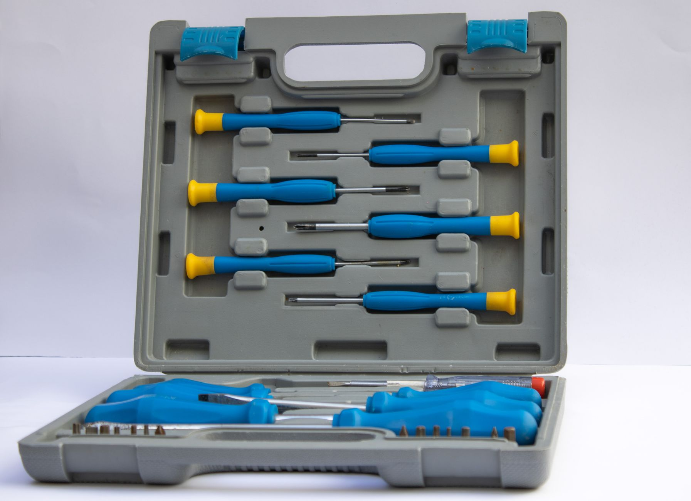

A shop vacuum looks like the simplest purchase in the garage: plug it in, suck up sawdust, done. But the spec sheet on a budget model and a premium one both say "wet/dry," both list a tank size in gallons, and both advertise a horsepower number that doesn't mean what it implies. The gap between a vacuum that clogs on wood shavings after ten minutes and one that keeps pulling air through a shop full of drywall dust comes down to a handful of specs that are easy to compare once you know what they actually measure, not which one has the biggest number on the box.

**Quick answer:** For most garages and home workshops, a 10-12 gallon corded shop vacuum rated around 5.0-6.0 peak HP, with roughly 150+ CFM of real airflow, covers sawdust, shop debris and the occasional spill without being too bulky to drag around. Go smaller (4-6 gallons) if you're mainly cleaning a car interior or a small apartment workbench, and size up to 16-20 gallons if you're clearing out after major renovation work or pumping up standing water. Skip cordless models unless portability matters more to you than runtime and suction, since battery-powered shop vacuums trade tank capacity and continuous power for the ability to walk away from an outlet. Whichever size you land on, match the filter to the job: a dry filter clogs almost immediately in wet mode, and a wet filter won't trap fine dust.

## CFM vs. Peak Horsepower: The Spec That Actually Matters

Nearly every shop vacuum box advertises "peak horsepower," a number measured with the motor spinning freely, disconnected from any airflow resistance. It's a real measurement, but it tells you almost nothing about how the vacuum performs once a hose, filter and clogged nozzle are all fighting against that motor. Two vacuums with identical peak HP ratings can perform very differently once you're pulling debris through 10 feet of hose.

The specs that actually predict performance are CFM (cubic feet per minute — how much air volume the vacuum moves) and water lift or sealed suction (how much vacuum pressure it can generate, usually listed in inches of water lift). High CFM clears bulky, light debris fast — sawdust, leaves, packing peanuts. High water lift pulls fine or dense material through a hose and filter without stalling — wet debris, fine dust, gravel. A vacuum built for woodworking cleanup wants CFM; one built for wet basement cleanup or fine drywall dust wants both CFM and water lift. If a listing only advertises peak HP and skips CFM and water lift entirely, treat that as a sign the actual airflow numbers aren't competitive.

## Tank Size: Matching Gallons to the Job

Tank size drives both how long you can work before emptying it and how heavy and bulky the vacuum is to move around. Bigger isn't automatically better — a 20-gallon tank you have to wrestle up a step to dump is worse than a 10-gallon one you empty twice.

- **4-6 gallons:** Car interiors, small apartment workshops, light cleanup after a weekend project. Light enough to carry one-handed; you'll empty it often on a real job.
- **8-10 gallons:** The sweet spot for most DIYers — enough capacity for an afternoon of sanding or a garage sweep-out without emptying mid-task, still manageable to carry to a dump spot.
- **12-16 gallons:** Renovation debris, a dedicated woodworking shop, or anyone collecting wet and dry mess over a full day. Expect wheels to matter more than a handle at this size.
- **20+ gallons:** Flood cleanup, construction sites, or pumping standing water after a sump pump failure. These are usually mounted on a dolly and are overkill for routine garage use.

If your garage already runs a shared [battery platform](/blog/cordless-drill-buying-guide/) for other tools, that's one more reason to lean corded here — tank size and motor power matter more for a shop vacuum than for a drill, and battery packs add cost without adding capacity.

## Filters: Dry, Wet, and HEPA

The filter is the part most owners ignore until it fails, and using the wrong one is the single most common reason a shop vacuum underperforms or breaks early.

| Filter type | Built for | What happens if you use it wrong |
|---|---|---|
| **Pleated paper/cartridge** | Dry debris: sawdust, dirt, leaves | Soaking it in wet mode destroys the pleats and the paper disintegrates |
| **Foam sleeve** | Wet pickup: spills, standing water | Fine dust clogs the foam almost instantly, killing suction |
| **HEPA cartridge** | Fine dust: drywall sanding, concrete dust, mold remediation, allergens | A standard filter in these jobs lets fine particulate blow straight back into the air you're breathing |
| **No filter / foam-free wet mode** | Pumping larger volumes of water | Running without a filter in dry mode sends dust straight through the motor housing |
| **Disposable dust bag (used with a filter)** | Keeping fine dust contained when you empty the tank | Skipping the bag means a cloud of dust every time you dump a full tank of drywall debris |

A practical setup for most garages is one dry pleated filter for everyday use, a foam sleeve kept on hand for wet jobs, and a HEPA cartridge reserved specifically for drywall or sanding dust. Switching filters takes under a minute and avoids ruining a filter that isn't rated for the material you're vacuuming.

## Corded vs. Cordless Shop Vacuums

| | Corded | Cordless (battery) |
|---|---|---|
| **Runtime** | Unlimited | Typically 10-25 minutes per battery, depending on suction setting |
| **Suction power** | Generally stronger, especially at larger tank sizes | Noticeably weaker at the high end; fine for light cleanup |
| **Tank size available** | Up to 20+ gallons | Mostly 2-6 gallons; large cordless tanks are rare and pricey |
| **Best for** | Workshop base, garage, job site with an outlet | Car interiors, quick spills, cleanup in spots without easy power access |
| **Ongoing cost** | None beyond the vacuum | Extra batteries add up, though they may share a platform with other cordless tools |

Cordless makes the most sense when you're already invested in one battery platform and want a small vacuum that shares chargers with your drill and impact driver, or when the job is genuinely cord-length-limited — cleaning out a vehicle, a shed with no outlet, or a quick spill upstairs. For anything that involves sustained debris pickup — a full garage sweep, a woodworking session, wet cleanup after a leak — a corded vacuum's unlimited runtime and stronger sealed suction outperform a battery unit every time.

## Which Shop Vacuum Fits Your Situation

| Situation | Recommended size | Key feature to prioritize | Skip |
|---|---|---|---|
| Car detailing, small apartment workshop | 4-6 gal | Lightweight, narrow nozzle attachments | Large tank, high CFM |
| General garage and weekend DIY | 8-10 gal | Balanced CFM + water lift, wheeled base | Cordless-only models |
| Woodworking shop, frequent sawdust | 10-16 gal | High CFM, dust-collection port for tool hookup | Undersized hose diameter |
| Drywall or sanding cleanup | 10+ gal | HEPA filter compatibility | Standard paper filter alone |
| Wet basement, burst pipe, minor flooding | 12-20 gal | High water lift, auto shutoff float, pump-out hose | Small tank, no float shutoff |
| Quick spills, car, no outlet access | 2-4 gal cordless | Portability, shared battery platform | Expecting job-site-level suction |

## Accessories Worth Having

The stock hose and floor nozzle handle maybe half of what a garage actually needs picked up. A few attachments do most of the remaining work:

- **Crevice tool:** Gets into corners, along baseboards, and around workbench edges where the wide nozzle can't reach.
- **Wet nozzle (squeegee-style):** A rubber-edged attachment that pulls standing water off a floor far faster than the standard bristled floor tool.
- **Extension wand:** Useful for reaching gutters, high shelves or under a vehicle without crouching the whole time.
- **Dust collection adapter:** Connects the hose directly to a table saw, miter saw or sander port, pulling sawdust at the source instead of sweeping it up afterward — a real upgrade if you already built a [garage workbench](/blog/diy-garage-workbench/) and run power tools regularly.
- **Replacement/spare filters:** Keeping a spare of both the dry and wet filter means you're never stuck choosing between the wrong filter and no vacuum at all.

## Common Shop Vacuum Mistakes

| Mistake | Why it backfires | Better approach |
|---|---|---|
| Vacuuming water with a dry paper filter installed | Destroys the filter and can let water reach the motor | Swap to a foam sleeve or remove the filter per the manual before wet pickup |
| Vacuuming fine drywall or sanding dust through a standard filter | Clogs almost instantly, or lets fine particulate blow back into the air | Use a HEPA-rated filter and a dust bag for fine debris |
| Ignoring the float shutoff during wet pickup | Overfilling can send water into the motor and ruin the vacuum | Stop and empty as soon as suction noticeably changes pitch — that's usually the float engaging |
| Using a narrow hose for bulky or wet debris | Clogs repeatedly, kills airflow | Match hose diameter to the material — wider for wet or bulky debris |
| Leaving wet debris in the tank overnight | Grows mold and odor in the tank and filter | Empty and rinse the tank the same day after any wet job |
| Running the vacuum with no filter and no bag in dry mode | Fine dust passes straight through and can damage the motor over time | Always run a dry-mode filter unless actively pumping water |

## Safety Notes

A shop vacuum pulling standing water near an electrical outlet is a real shock hazard — use a GFCI-protected outlet for any wet pickup, and never run an extension cord through standing water. Never vacuum hot ash, embers, or anything that's recently been near a flame; a standard shop vacuum filter can't handle the heat and the fine ash can smolder inside the tank hours later. Fireplace and wood-stove ash needs a dedicated ash vacuum rated for that heat, a distinction worth knowing if you're also working through our guide to [getting a fireplace and chimney ready for winter](/blog/fireplace-chimney-ready-for-winter/). Fine dust from sanding or drilling into old paint, drywall or concrete can also pose a respiratory hazard beyond what the vacuum filters out of the air — wear a respirator rated for the material, not just the vacuum's filter, when working with it for extended periods. And if you're facing standing water from a failed sump pump or a burst pipe deep enough to need more than a tank or two of pumping, call a water-damage restoration professional instead of relying on a shop vacuum — persistent flooding points to a problem that needs fixing at the source, not just mopping up after. [Winterizing outdoor faucets](/blog/how-to-winterize-outdoor-faucets/) before the first hard freeze is a cheap way to avoid the burst-pipe version of this problem.

## FAQ

### What's the real difference between CFM and peak horsepower?

Peak horsepower measures the motor spinning with no resistance, which tells you almost nothing about real-world suction. CFM measures actual air volume moved, and water lift measures the pressure available to pull debris through a hose and filter. A vacuum with a high peak HP number but no listed CFM or water lift figure is usually hiding a weaker real-world performance.

### Can a shop vacuum replace a regular vacuum cleaner for floors and carpet?

Not well. Shop vacuums are built for debris and spills, not fine household dust and allergens on carpet fiber, and most lack the brush-roll agitation a regular vacuum uses to lift dirt out of carpet pile. They're excellent for garages, workshops and hard-surface spills, but keep a standard vacuum for everyday household floors.

### Do I need a HEPA filter if I only vacuum occasionally?

If you're only picking up sawdust, leaves or the occasional spill, a standard dry filter is fine. HEPA matters specifically for fine particulate — drywall dust, concrete dust, mold remediation, or anyone with allergies or respiratory sensitivity who's regularly in the space afterward. It's worth owning as a spare cartridge rather than your everyday filter.

### How big a hose diameter do I actually need?

Most shop vacuums come with either a 1¼-inch or 2½-inch hose. The narrower 1¼-inch hose has higher velocity and works well for fine debris and dust-collection hookups to tools, but it clogs quickly on bulky or wet material. The wider 2½-inch hose moves more volume with less clogging and is the better all-around choice for general garage and wet cleanup, even though it's less precise for detail work.
