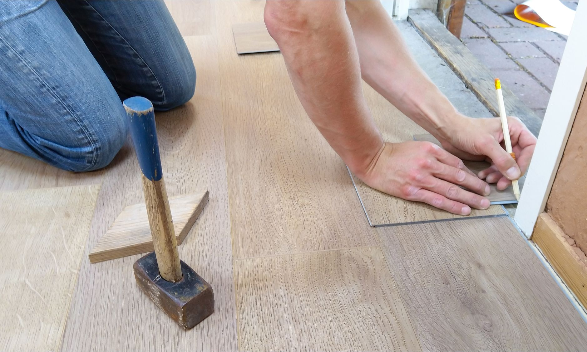

A sump pump that worked fine in last spring's thaw can still fail the next time you need it, and most homeowners find out the hard way: a frozen discharge line, a stuck float switch, or a check valve that's quietly been letting water drain back into the pit for months. Fall is the time to catch these — the same pre-season window worth spending on your [furnace](/blog/get-furnace-ready-for-winter/) — before heavy rain, early freezes and snowmelt put the pump back to work. None of the checks below take more than an hour, and skipping them is how a $200 pump turns into thousands of dollars in basement water damage.

**Quick answer:** Pour several gallons of water into the sump pit to confirm the float switch triggers the pump, it empties the pit within a minute or two, and it shuts off cleanly. Clean debris from the pit and the pump's intake screen, confirm the check valve holds water in the discharge pipe instead of letting it drain back down, and make sure the discharge line empties at least 10-20 feet from the foundation and isn't frozen or blocked. If your area loses power during storms, add a battery backup or water-powered backup pump — a primary pump alone does nothing during an outage, which is exactly when many basements flood. Replace a pump older than 7-10 years, or sooner if it's been running constantly or making grinding or rattling noises.

## Why Sump Pump Failures Happen at the Worst Time

Sump pumps fail quietly. Unlike a furnace that won't start or an [outdoor faucet](/blog/how-to-winterize-outdoor-faucets/) that freezes solid, a dead pump usually gives no warning — it just sits in a dry pit doing nothing until the water table rises and it's needed. A pump can sit idle for months, its float switch can seize in one position, its check valve can fail open, and none of it shows up until the first heavy rain or spring thaw sends water into the pit and the pump either doesn't start or can't keep up.

Power outages make the timing worse. Many sump pump failures aren't really pump failures — they're power failures during exactly the kind of storm that also floods basements. A pump that's mechanically perfect is useless the moment the breaker trips or the grid goes down. Water finds its way into a home through more than one path each winter — [ice dams](/blog/how-to-prevent-ice-dams/) at the roofline are one, a flooded sump pit is another — and both call for a check before the season really starts.

## How the System Works

A typical sump system has four parts, and understanding each one tells you what you're actually testing:

- **The pit (sump basin):** A plastic or concrete liner set into the lowest point of the floor, where groundwater collects before it can spread.
- **The pump:** Submersible pumps sit inside the pit and are most common in newer installations; pedestal pumps sit above the pit with only the intake submerged, and are easier to service but noisier.
- **The float switch:** A mechanical or electronic switch that rises with the water level and turns the pump on at a set height, then off once the water drops.
- **The check valve and discharge line:** A one-way valve just above the pump that stops water in the discharge pipe from draining back into the pit between cycles, before that line carries the water away from the house.

A failure in any one of these four parts can flood a basement even if the other three work perfectly, which is why the test below checks each one.

## What You'll Need

- A 5-gallon bucket (to add water to the pit if it's currently dry)
- A flashlight
- Work gloves
- A shop vacuum or a stiff brush for cleaning the pit
- A permanent marker or painter's tape (to mark the discharge pipe or breaker)
- Optional: a battery backup sump pump system, or a water-powered backup pump, if you don't already have one

## Step-by-Step: Testing and Maintaining Your Sump Pump

1. **Locate the breaker and confirm the pump is plugged into a dedicated, grounded GFCI outlet.** Never run it on an extension cord as a permanent setup; a loose or worn cord is a shock hazard in a wet pit.
2. **Remove the pit lid and inspect the water level and walls.** A little standing water between rains is normal; a pit that's been dry for a long time still needs testing, since a pump that hasn't run in months is the one most likely to have a stuck float.
3. **Fill the pit with water from a bucket until the float switch lifts.** Watch for the pump to kick on within a few seconds — a delayed or no-start response usually means a stuck float arm, a tangled float cord, or a failed switch.
4. **Time how long the pump takes to empty the pit back to its resting level.** Most residential pumps clear a standard pit in under two minutes. A pump that runs far longer, or barely lowers the water, is often struggling with a clogged intake screen or a worn impeller, not a power problem.
5. **Confirm the pump shuts off cleanly** once the float drops, rather than running dry or cycling rapidly. Short-cycling (on and off every few seconds) usually means the float switch is set too close to off, or is picking up vibration from its own discharge water.
6. **Unplug the pump and lift it out to clean the intake screen**, the mesh opening where water enters the housing. Grit and debris that settle in the pit over months are the single most common cause of reduced output, and this step is the one most homeowners skip.
7. **Check the check valve.** Look at the discharge pipe just above the pump — most valves show a flow-direction arrow. Lift the pump briefly while watching the pipe above it: if that water drains back down into the pit instead of staying put, the valve isn't sealing and needs replacing. A failed valve forces the pump to re-pump the same water every cycle, shortening its life.
8. **Follow the discharge line outside and confirm it empties at least 10-20 feet from the foundation**, angled away from the house, so the water doesn't just seep back toward it. Check that the outdoor end isn't aimed somewhere it will ice over — a frozen discharge is one of the most common reasons a perfectly working pump still floods a basement in winter.
9. **Vacuum or sweep debris from the pit floor** before replacing the pump and lid, so grit doesn't immediately re-clog the screen you just cleaned.

## Primary vs. Backup Power: What Actually Protects You During an Outage

A primary pump handles normal groundwater. What matters most is what happens when the power goes out during the storm that's also pushing more water toward your foundation — a common enough overlap that "my pump is new" isn't the same question as "my basement is protected."

| Option | How it works | Runtime | Best for |
|---|---|---|---|
| **Battery backup pump** | A second pump, wired to a deep-cycle battery, that kicks in if the primary loses power or can't keep up | Hours to a day or more, depending on battery size | Most homes, especially after a past outage during heavy rain |
| **Water-powered backup pump** | Uses household water pressure to create suction that ejects water, no battery involved | As long as municipal water pressure holds | Homes on municipal water that want backup with zero battery upkeep |
| **Portable or standby generator** | Powers the existing primary pump during an outage | As long as fuel lasts | Homes already using a generator for other needs — see our [portable generator buying guide](/blog/portable-generator-buying-guide/) for sizing, since starting watts matter more than running watts |
| **No backup** | Primary pump only | None during an outage | Not recommended anywhere basement flooding is a real risk |

A battery backup is the most common choice because it activates automatically within seconds of a power loss, which matters because most flooding outages happen overnight or while no one's home to start a generator. A generator is a reasonable backup only if someone is actually there to start and fuel it — it does nothing for a pump during the hours before anyone notices the power is out.

If your basement has finished flooring like this, the stakes of a pump failure are higher than an empty, unfinished space — water that would just dry off a concrete slab can ruin underlayment and planks that took a weekend to install. A battery backup is cheap insurance against replacing a finished floor, not just against a wet, unfinished pit.

## Common Sump Pump Problems

| Symptom | Likely cause | Fix |
|---|---|---|
| Pump doesn't start when the pit fills | Stuck or tangled float switch, tripped GFCI outlet, dead motor | Free the float arm, reset the GFCI, test the outlet; replace the pump if the motor won't run at all |
| Pump runs constantly, never shuts off | Float switch stuck "up," or a continuous water source like a broken pipe feeding the pit | Check float travel and adjust per the manual; investigate the source if it never stops filling |
| Pump short-cycles (on and off rapidly) | Float switch set too close together, or vibration from the discharge stream agitating the float | Reposition the float switch or add a float guard/tube to shield it from turbulence |
| Water drains back into the pit after the pump shuts off | Failed or missing check valve | Install or replace the check valve just above the pump's discharge connection |
| Pump runs but water level barely drops | Clogged intake screen, worn impeller, or undersized pump for the inflow | Clean the screen first; if output is still weak, the pump may need replacing or upsizing |
| Basement flooded despite a working pump | Power outage during the storm, or a frozen/blocked discharge line outside | Add battery or water-powered backup; clear or reroute the discharge outlet before winter |
| Loud grinding, rattling or humming without pumping | Worn bearings, jammed impeller, or a pump that's seized | Unplug and inspect for debris in the impeller; replace the pump if it's old or the noise continues |
| Musty smell or visible rust/corrosion on the pump | Pump nearing the end of its service life (most last 7-10 years) | Plan a replacement before it fails outright, ideally before the next wet season |

## Safety Notes and When to Call a Professional

A sump pit combines electricity and standing water, so treat the basics seriously: unplug the pump before reaching into the pit, confirm the outlet is GFCI-protected, and never work on the system during an active flood with the power still connected. If the pit or floor is wet from something other than normal groundwater — a sewage smell, for instance — call a plumber rather than assuming it's the sump system; a sewage ejector pump is a related but different device.

Call a professional if the pump runs constantly with no clear cause, if the issue looks like drainage or grading rather than the pump, if a backup system means working with your plumbing or electrical panel, or if a flood has already happened and left standing water or insulation needing remediation beyond a wet-dry vacuum. A plumber or waterproofing contractor can also tell you whether a struggling pump is simply undersized for your soil and water table.

## FAQ

### How often should I test my sump pump?

At least twice a year — once in fall before winter freezes and heavy rain return, and once in spring before snowmelt. With frequent storms or a consistently high water table, a quarterly check takes only a few minutes and catches problems sooner.

### How long do sump pumps usually last?

Most submersible pumps last 7-10 years with normal use, though one running constantly because of a high water table may wear out sooner. If yours is approaching that age, treat a fall checkup as the moment to decide on a proactive replacement rather than waiting for it to fail mid-storm.

### Does a battery backup pump need ongoing maintenance?

Yes. The battery needs periodic checking — most deep-cycle batteries used for this should be tested or replaced every 3-5 years, and many systems include a charge indicator worth checking monthly. A backup with a dead battery gives the same false security as no backup at all.

### Can I just run a garden hose from the pit instead of installing a pump?

No. A sump pit fills from groundwater seeping in continuously, often faster than gravity alone can drain through a hose, and a hose has no check valve or automatic trigger — it's not a substitute for a pump with a working float switch.
