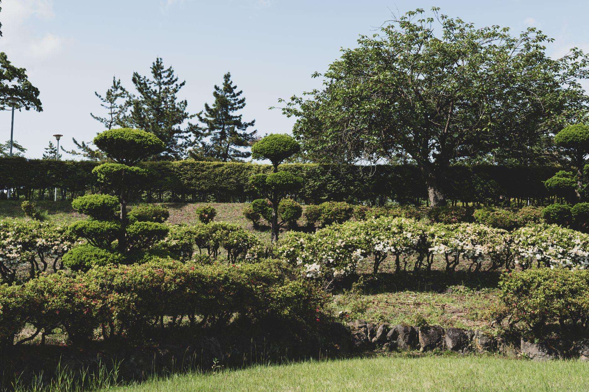

If you've got a stack of seed packets left over from this year, or a wish list of perennials you never got around to starting, late fall and early winter is exactly when to use them — not by waiting for a grow light setup in February, but by sowing them directly into the cold outdoors, inside a recycled jug. Winter sowing sounds counterintuitive the first time you hear it: you're deliberately planting seeds into containers that will sit outside through snow, hard freezes, and thaws, with no heat mat, no grow light, and no indoor space required. For a specific group of seeds, that exposure isn't a risk — it's the exact trigger they're built to wait for, and it's a good project to fold into whatever else is left on your pre-freeze list, [spring bulbs included](/blog/how-to-plant-spring-bulbs-in-fall/).

**Quick answer:** Winter sowing works by mimicking what cold-hardy and cold-stratifying seeds experience naturally: a period of freezing and thawing that breaks seed dormancy, followed by the first stretch of warm, sunny days in late winter or early spring that trigger germination. You sow seeds into vented, translucent containers (milk jugs are the classic choice) filled with moist seed-starting mix, then leave them outside, uncovered by anything but their own lid, from midwinter until they sprout on their own schedule. It works best for cold-hardy vegetables, hardy annuals, and native or perennial wildflowers that need cold stratification — not for tender, heat-loving vegetables like tomatoes and peppers, which gain nothing from the cold and need a warm germination temperature winter sowing can't provide until much later in the season anyway.

## What Winter Sowing Is and Why It Works

Winter sowing uses translucent, vented containers as miniature greenhouses that sit outdoors all winter, exposed to the same freezing temperatures, snow, and rain as the ground around them. Inside, the seed-starting mix freezes and thaws along with the outdoor temperature, which is the point: many perennial and wildflower seeds stay dormant until they've experienced a real winter, a built-in safeguard against germinating on a warm autumn day only to be killed by the first hard freeze.

The container does three things a bare garden bed can't. It holds moisture more consistently than open soil, so seeds don't dry out between snow or rain events. It creates a slightly warmer microclimate once the sun comes out, nudging germination earlier than seeds sown directly in the ground nearby. And it keeps seeds and soil in one contained spot, which matters for small or fine seeds that would otherwise wash away or get buried too deep by freeze-thaw heaving. Once seedlings sprout in late winter or early spring, they're already acclimated to outdoor light, temperature swings, and wind — they skip the hardening-off period that seedlings started indoors under lights need before going in the ground.

## Which Seeds Are Good Candidates for Winter Sowing

The method only pays off for seeds that actually benefit from cold exposure or that tolerate hard frost as seedlings. Seeds that need warm soil to germinate gain nothing from sitting in a frozen jug — they'll simply wait, unharmed but ungerminated, until the jug warms up well past the point you could have just started them indoors on a normal schedule.

| Seed type | Why winter sowing suits it | Examples |
|---|---|---|
| Native perennials & wildflowers needing cold stratification | Many won't germinate at all without a cold period; winter sowing provides it outdoors, no fridge required | Echinacea, milkweed, black-eyed Susan, columbine, lupine, coneflower |
| Cold-hardy vegetables & greens | Germinate at cool soil temperatures and tolerate light frost as seedlings | Kale, spinach, lettuce, Swiss chard, broccoli |
| Hardy annuals | Seedlings shrug off frost; many self-sow outdoors in nature anyway | Snapdragons, larkspur, bachelor's buttons, poppies, pansies |
| Cold-tolerant herbs | Germinate in cool conditions without rushing | Parsley, cilantro, chives |
| Tender, heat-loving vegetables (poor fit) | Need warm soil (65°F+) to germinate; cold exposure provides no benefit and only delays them | Tomatoes, peppers, eggplant, basil |
| Tender annuals (poor fit) | Frost-killed as seedlings even if they do sprout early | Zinnias, marigolds, impatiens |

If you're unsure where a seed falls, check the packet: "direct sow after last frost" or "needs warm soil to germinate" signals a poor winter-sowing candidate, while "self-sows," "needs cold stratification," or "direct sow in fall" signals a good one.

## What You'll Need

**Materials**
- Translucent plastic jugs or containers, 1 gallon or larger (milk jugs, distilled water jugs, or large clamshell produce containers all work)
- A utility knife or sharp scissors, for cutting the container
- A drill, soldering iron, or something to melt/punch ventilation and drainage holes
- Seed-starting mix (not garden soil, which compacts and drains poorly in a container)
- Seed packets for your chosen cold-hardy, hardy-annual, or stratification-needing varieties
- A permanent marker and duct tape, for labels that won't fade in sun and snow
- Duct tape or packing tape, to reseal the cut container

**1. Rinse and dry the container.** A milk jug carries some residue even after a quick rinse; a more thorough wash keeps mold from getting a head start once the container is sealed and humid.

**2. Cut around the jug, leaving a hinge.** Cut horizontally around the container about 4 inches up from the bottom, stopping just short of a full circle so a 1–2 inch section under the handle stays connected as a hinge. This lets the top flip open like a lid instead of coming off entirely, which keeps the two halves aligned when you tape it shut later.

**3. Punch drainage holes in the bottom** — four or five, roughly 1/4 inch across, so melting snow and rain don't pool and rot the seeds.

**4. Punch ventilation holes in the top,** including through the cap if you're leaving it on (most people remove the cap entirely instead, which is simpler and provides more airflow).

## Step-by-Step: Filling, Sowing, and Sealing

1. **Add 3–4 inches of moistened seed-starting mix** to the bottom half of the jug. Moisten the mix before adding it — it should feel like a wrung-out sponge, not dripping wet — rather than trying to water it evenly after the seeds are already down.
2. **Sow seeds at the depth listed on the packet.** Fine seeds that need light to germinate (many wildflowers) go on the surface and get pressed in rather than covered; larger seeds get covered per the packet's depth.
3. **Label immediately, in two places.** Write the variety and sow date on a strip of duct tape stuck to the outside of the jug, and tuck a second label — a cut strip of window blind or a plastic knife with writing in permanent marker — down into the soil itself. Exterior labels fade or peel over a winter outdoors; a backup inside the container is what saves you from a spring full of mystery seedlings.
4. **Close the hinge and tape the seam.** Run duct tape all the way around the cut line so the two halves act as one rigid container again — wind and settling snow will pop an untaped seam open.
5. **Set the jug outside right away.** There's no indoor holding period; the whole point is immediate, consistent outdoor exposure from the day you sow.

## Where and How to Place Your Containers

Set jugs somewhere they'll get full sun once the days start lengthening, since that sun exposure through the translucent plastic is what eventually warms the soil enough to germinate — a spot that stays in deep shade all winter lags well behind one with good late-winter sun. A south- or east-facing wall, deck, or patio works well, and keeps containers easy to check without trudging across the yard.

Snow on top of the jugs isn't a problem — it insulates and adds moisture as it melts. What you do need to manage is wind: an unweighted jug blows over easily, dumping soil and seeds out through the ventilation holes. Set a brick or landscape stake alongside each jug, or push several together, to keep them upright through a windy stretch. If you're also finishing other pre-winter tasks, pair this with [dividing and transplanting any perennials that still need moving before the ground freezes hard](/blog/divide-and-transplant-perennials-in-fall/), since both jobs want to be done before the coldest stretch sets in.

Check containers every week or two for moisture — lift the jug and gauge its weight, or peek at the soil surface. If the mix looks dry, which happens more on a mild, windy week than a snowy one, add water from the top. Leave the cap off and the lid vented all winter; resist sealing things up tighter during a cold snap, since the method depends on the container tracking outdoor temperature, not resisting it.

## Winter Sowing vs. Other Seed-Starting Methods

| Method | Equipment needed | Best for | Trade-off |
|---|---|---|---|
| **Winter sowing (jugs outdoors)** | Jugs, seed mix, tape — no lights or heat | Cold-hardy vegetables, hardy annuals, cold-stratifying perennials | Germination timing is weather-dependent, not on your schedule |
| **Starting seeds indoors under lights** | Grow lights, trays, heat mat, indoor space | Tender vegetables and annuals that need warm soil and a long head start | Requires [a dedicated setup and hardening-off period](/blog/how-to-start-seeds-indoors/) before transplanting outside |
| **Direct sowing in spring** | Nothing beyond the bed itself | Fast-maturing crops and anything that resents transplanting | Misses the cold-stratification trigger many perennials need; later start overall |
| **Fridge stratification** | Damp paper towel, zip bag, fridge space | Perennial seeds when you want precise timing before starting them indoors | More hands-on monitoring; still needs a follow-up indoor or outdoor sowing step |

Winter sowing and indoor starting aren't competing methods so much as complementary ones — use jugs for what tolerates or needs the cold, and save indoor space and grow lights for tender crops. If you're planning next year's vegetable layout, winter is a reasonable time to revisit [which crops grow well next to each other](/blog/companion-planting-guide/) so you know what you're sowing for.

## Common Mistakes

| Mistake | Cause | Fix |
|---|---|---|
| Mold or a sour smell inside the jug | Too little ventilation, or soil kept too wet | Prop the lid open further or remove the cap entirely; let the surface dry slightly between checks |
| Seeds never sprout at all | Wrong seed type for the method — a heat-loving variety sown by mistake | Move that packet to an indoor seed-starting setup instead; don't keep waiting on the jug |
| Jug tips over or blows away | Container left unweighted in an exposed, windy spot | Weight the base with a brick, or cluster several jugs together |
| Seedlings crowded and leggy after sprouting | Seeds sown too thickly, or jug left sealed too long after germination | Thin crowded seedlings; vent the top further once true leaves appear |
| Labels unreadable by spring | Writing faded on tape left exposed to sun and snow | Duplicate the label inside the soil with a weatherproof marker, not just on the exterior |
| Transplanted too early, into still-frozen ground | Eagerness to get seedlings in the garden as soon as they sprout | Wait for the soil itself to be workable, not just for seedlings to appear, and transplant on an overcast day |

## FAQ

### When should I start winter sowing?

Any time from late fall through midwinter works, since the point is giving seeds a real stretch of cold before the thaw — many gardeners start in December and continue into January or even February in colder zones. There's no hard deadline the way there is with counting back from a last frost date; you're working with the whole winter, not a narrow window.

### Do I need to water winter-sown jugs if it's snowing?

Snow sitting on an open or vented jug will melt into it and add moisture on its own, so extra watering usually isn't needed during snowy stretches. Check more closely during dry, windy cold snaps with no snow cover, when the mix can dry out without you noticing.

### What do I do once seedlings sprout in spring?

Start venting the container more as temperatures rise consistently — prop the lid open further, then remove it, before finally cutting the top off entirely once nights stay reliably above freezing. Because the seedlings have been outdoors the whole time, they don't need a separate hardening-off period the way indoor-started seedlings do; transplant them once the soil is workable and they have a couple sets of true leaves.

### Can I reuse the same jugs next winter?

Yes, as long as they're rinsed out and the vent and drainage holes are still clear. Check the tape seam each year, since a season of sun and cold usually leaves it brittle, and replace it rather than relying on tape that's already lifting at the edges.
