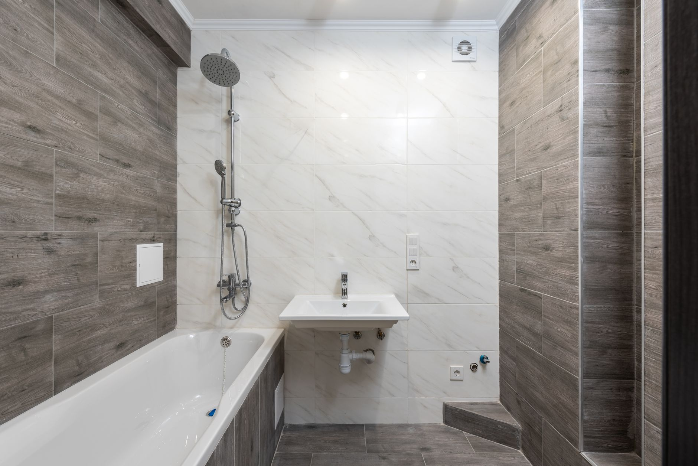

Every winter, the same pattern shows up on a lot of windows: clear in the evening, fogged by morning, sometimes with enough water pooled on the sill to need a towel before it soaks into the frame or the drywall below. It's easy to blame the windows themselves, and sometimes that's fair — but condensation is just as often a sign that the air inside your home is carrying more moisture than it can hold once it touches a cold surface, and the window is simply the coldest surface in the room. Knowing which one you're dealing with changes what you actually need to fix.

**Quick answer:** Window condensation happens when warm, humid indoor air meets a cold glass surface and the water vapor in that air condenses into liquid, the same way a cold drink sweats in summer. Light condensation on single-pane or older double-pane windows on a cold morning is usually just high indoor humidity relative to how cold the glass is, and the fix is lowering humidity and improving airflow — running bathroom and kitchen exhaust fans, cracking a window briefly, or using a dehumidifier to bring indoor relative humidity down into the 30–40% range most homes should target in winter. Condensation that shows up *between* the two panes of a double-pane window, rather than on the inside surface, means the seal has failed and that's a glass unit replacement, not a humidity fix. Either way, condensation that sits on wood sills or frames for days at a time is worth addressing quickly, since that's exactly the moisture mold needs to take hold.

## What's Actually Causing the Moisture on Your Glass

Indoor air holds moisture from sources most households don't think about until winter makes it visible: showers and cooking, drying laundry indoors, houseplants, fish tanks, and simply breathing — a family of four can add several pints of water vapor into the air over a day without anyone running a humidifier on purpose. In summer, that moisture usually isn't a problem because warm air holds a lot of water vapor before it condenses. In winter, the same amount of moisture in the air meets glass that can be 20 or 30 degrees colder than the room, and that temperature drop is what pushes the water vapor past its saturation point and onto the surface as liquid.

Newer, well-sealed homes make this worse, not better, in one specific way: tighter construction and good weatherstripping — the kind covered in [sealing drafts around doors and windows](/blog/how-to-weatherstrip-doors-and-windows/) — keeps conditioned air in, which is good for heating bills, but it also keeps humid air from escaping on its own the way it would through gaps in an older, leakier house. That's exactly why mechanical ventilation (exhaust fans, a cracked window, an HRV if your home has one) matters more as a house gets tighter, not less.

## How Much Condensation Is Normal, and When It's a Warning Sign

A light, thin fog on the lower corners of a window on the coldest mornings, that clears once the sun comes up or the heat kicks on, is common and not something to panic over. What crosses into a real problem is condensation heavy enough to run down the glass and pool on the sill, frost that builds up on the inside of the glass overnight, or dampness that doesn't fully dry out before the next cold night adds more. At that point you're not just dealing with annoying fog — you're giving mold and wood rot exactly the sustained moisture they need, right at a sill or frame joint that's often already hard to inspect.

The other distinction worth making early: condensation on the room-side surface of the glass is a humidity and ventilation issue you can fix yourself. Condensation or a persistent haze trapped *between* the panes of a double-pane or triple-pane window is a manufacturing seal that's failed, letting moist air into the gas-filled gap between the panes — no amount of dehumidifying touches that, because the moisture causing it isn't in your room air at all.

## Diagnosing the Cause: Where the Moisture Shows Up and What It Means

| Where you see it | What it usually means | What actually fixes it |
|---|---|---|
| Thin fog, lower corners only, clears by midday | Normal humidity meeting the coldest part of the glass | Nothing urgent; monitor if it worsens |
| Heavy condensation across the whole pane, every morning | Indoor humidity is too high for how cold the glass gets | Lower indoor humidity and improve airflow (see steps below) |
| Water on the sill or dripping onto the frame | Same humidity problem, advanced enough to need attention now | Fix the humidity source, dry the sill, check for early wood damage |
| Fog or haze between two panes of glass, not on either surface | The insulated glass unit's seal has failed | Replace the glass unit or the window; not a cleanable or humidity issue |
| Condensation mainly in one room (bathroom, basement, laundry area) | A local, high-moisture source in that specific room | Target that room's humidity and ventilation, not the whole house |
| Condensation plus a musty smell or visible spotting on the frame | Moisture has been sitting long enough to start mold growth | Clean affected areas and address the humidity source immediately; consider a professional mold assessment if it's spread beyond the glass |

## Step-by-Step: Lowering Indoor Humidity to Stop the Condensation

**What you'll need**
- A hygrometer (a simple humidity gauge) to see your actual indoor relative humidity instead of guessing
- Bathroom and kitchen exhaust fans that vent to the outside, not just into the attic
- A portable dehumidifier, sized for the room or area if the problem is localized
- Weatherstripping or caulk for any gaps found during inspection
- A microfiber cloth or squeegee for daily wipe-down during the worst stretches

**1. Measure before you guess.** Place a hygrometer in the room where condensation is worst and check it over a few mornings. Most homes should sit between 30% and 40% relative humidity in winter — below that, skin and sinuses get uncomfortably dry; above it, condensation risk climbs fast, especially overnight when temperatures drop and nobody's running fans.

**2. Run exhaust fans longer than feels necessary.** Keep bathroom fans running 15–20 minutes after a shower, not just while you're in it, and run the kitchen hood while boiling, steaming, or simmering anything for an extended period. The goal is venting moisture outside before it spreads through the house, not just clearing fog off the bathroom mirror.

**3. Move laundry drying and houseplant watering out of tight, poorly ventilated rooms** if condensation is concentrated in one area. A drying rack in a small, closed bedroom adds a surprising amount of moisture to that one room's air; spreading it out or venting that room helps more than treating the window itself.

**4. Add a dehumidifier to the worst-affected room** if fans and ventilation changes don't bring the number down within a week or two. Set it to maintain that 30–40% target rather than running continuously at maximum, and empty or drain it on a schedule so it keeps working.

**5. Re-check with the hygrometer after a week.** If humidity has come down into range and the glass is still fogging heavily, the problem has shifted from a humidity issue to a window-performance issue — worth revisiting the diagnosis table above.

## Fixing the Window Side of the Problem

Once humidity is under control and condensation is still heavy on a specific window, the window itself is contributing. Gaps around the frame let cold outside air mix with the warm interior right at the glass edge, making that spot colder than the rest of the pane and a magnet for condensation — the same gaps that waste heat are often the ones making the window sweat worst. Walk the frame with a lit incense stick or your hand on a windy day to feel for drafts, then seal what you find with fresh caulk on fixed joints and new weatherstripping on anything that opens, following the same approach used for [door and window weatherstripping](/blog/how-to-weatherstrip-doors-and-windows/).

For single-pane windows or older double-pane units without a failed seal, interior storm window kits or clear shrink film add a second air gap that keeps the room-side surface noticeably warmer, which directly reduces condensation risk — these are inexpensive, temporary, and removable in spring, which makes them a reasonable stopgap while you plan for anything more permanent. A failed double-pane seal, by contrast, isn't something caulk or film fixes; that calls for a replacement glass unit or, if the frame itself is failing too, a full window replacement, which is a bigger decision than this article covers but worth getting a quote on if more than one or two windows show the same between-the-panes fogging.

## Common Mistakes That Make Condensation Worse

| Mistake | Why it backfires | Fix |
|---|---|---|
| Running a humidifier all winter regardless of actual humidity | Adds moisture you may not need, pushing condensation risk higher | Check a hygrometer before adding humidity; only run a humidifier if levels are genuinely low |
| Wiping condensation off and stopping there | Treats the symptom, not the moisture source | Pair wiping with a ventilation or humidity fix so it doesn't just return the next cold morning |
| Sealing up a home tightly without adding ventilation | Traps the same moisture that used to escape through small gaps | Add or run exhaust fans more, especially after weatherstripping a drafty house |
| Caulking a double-pane window with a failed seal | Doesn't stop between-pane fogging and can trap existing moisture in further | Replace the glass unit instead of caulking over the symptom |
| Ignoring condensation on a finished basement window | Basements run more humid already, and mold growth there is harder to spot early | Treat basement window condensation as a higher priority, not a lower one |
| Closing curtains or blinds tightly over a cold window | Blocks the little bit of room-air circulation that helps the glass surface, and traps humidity right at the sill | Leave some airflow at the window, especially overnight in the coldest rooms |

## Safety Notes and When to Call a Professional

Persistent condensation that's left standing water on a wood sill or frame for more than a few days can start softening wood or growing mold within one to two weeks under the right conditions, so don't let it sit through a whole cold snap unaddressed. If you find soft, discolored wood at a sill or see mold spreading beyond a small, easily cleaned spot, that's worth a professional assessment rather than DIY cleanup — especially in a finished basement or a room with electrical outlets near the affected area. A failed double-pane seal is a glass or window replacement job for a window professional, not a sealant fix, and a whole-house humidity problem that doesn't respond to fans and a portable dehumidifier may point to a ventilation issue — such as a bathroom fan venting into the attic instead of outside — that's worth having an HVAC contractor check, since that same trapped moisture can also feed [ice dam problems at the roofline](/blog/how-to-prevent-ice-dams/) if it migrates upward into attic space.

## FAQ

### Is window condensation a sign my windows are bad or failing?

Not necessarily. Condensation on the room-side surface of the glass is almost always a humidity and ventilation issue, not a defect in the window itself — even high-quality, newer windows fog under high indoor humidity on a cold enough night. The one true window-defect sign is fogging or haze trapped between the panes of a double- or triple-pane unit, which means the seal has failed.

### What indoor humidity level should I aim for in winter?

Most heating and air-conditioning guidance points to roughly 30–40% relative humidity in winter as the range that balances comfort against condensation risk. Lower than that and you'll likely notice dry skin, static, and irritated sinuses; higher than that and condensation risk on cold glass climbs quickly, especially overnight.

### Can I fix condensation between double-pane window glass myself?

No. That moisture sits inside a sealed, gas-filled unit that isn't designed to be opened, so there's no DIY drying or resealing step that actually works. The practical fix is replacing the glass unit itself, or the whole window if the frame has deteriorated too.

### Will running my furnace fan constantly help with condensation?

Running the furnace's blower more can help even out temperature and reduce localized cold spots on glass, but it does nothing to remove excess moisture from the air — only ventilation (fans that vent outside, a dehumidifier, or cracking a window) actually lowers humidity. If you haven't done your seasonal furnace check yet, pairing that with your condensation fix is a reasonable way to handle both [winter furnace prep](/blog/get-furnace-ready-for-winter/) tasks at once. It's worth remembering, too, that the same heating season causing condensation on your windows is also why many people end up [raising humidity for houseplants that struggle with dry indoor air](/blog/raise-humidity-for-houseplants-in-winter/) elsewhere in the house — the fix for one room isn't necessarily the fix for the whole home.
